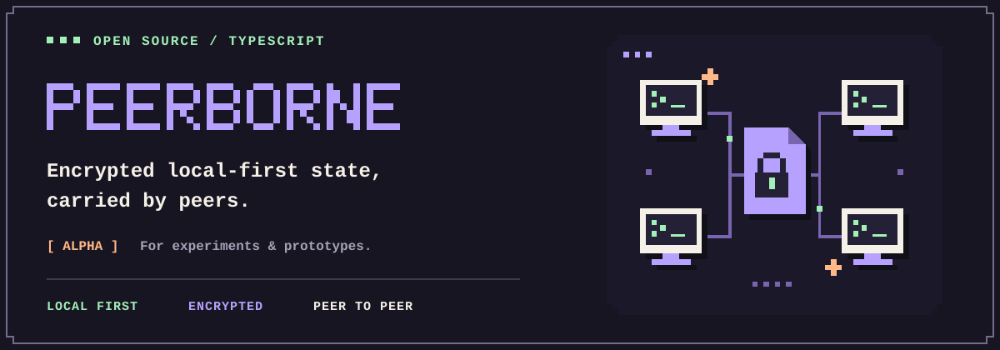
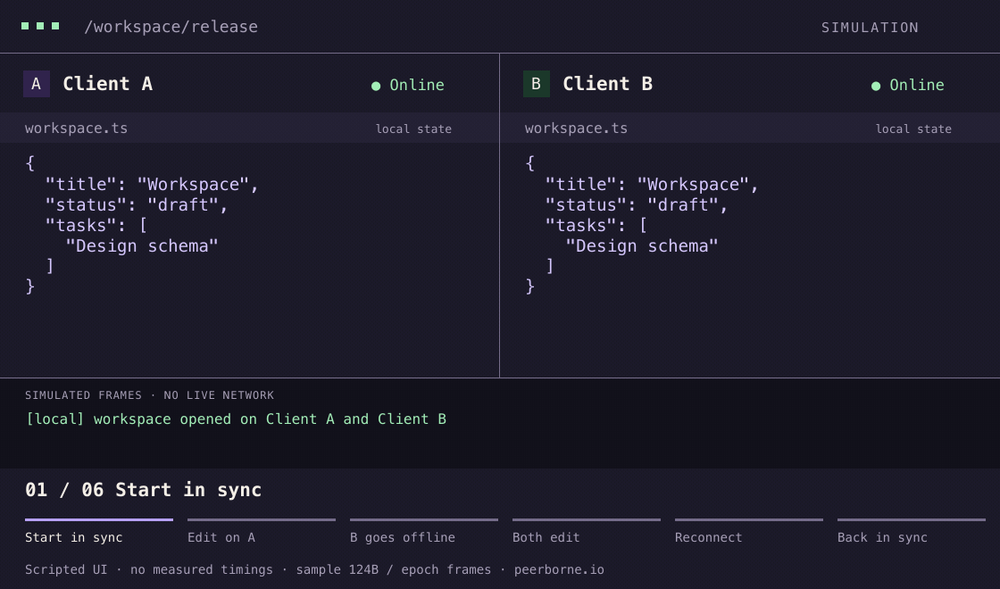
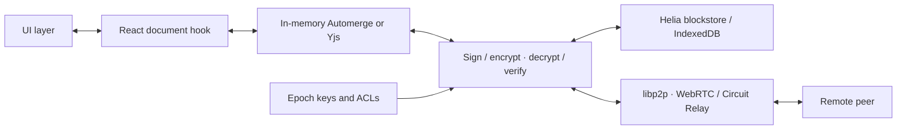

# Peerborne



**Local-first TypeScript state with end-to-end encryption. Your servers never see document plaintext.**

[](https://peerborne.io/)

[](https://github.com/Peerborne/peerborne/actions/workflows/ci.yml)
[](https://peerborne.io/)
[](LICENSE)

[**Try Peerborne Note →**](https://try.peerborne.io/) · [Run the quick start](https://peerborne.io/getting-started/quick-start/) · [Try the interactive demo](https://peerborne.io/) · [API reference](https://peerborne.io/reference/)

Peerborne wraps **Automerge or Yjs** documents with encryption, local storage, peer-to-peer networking, and React/Redux bindings. Edit a local replica; exchange encrypted updates with connected peers. Use it to prototype private collaborative workspaces, editors, and shared tools.

**Alpha · source workspaces only · not production-ready.** The animation is a scripted illustration. Its timing, 124B delta, and epoch messages are simulated; live partition/rejoin convergence still needs acceptance coverage. See the [feature audit](docs/feature-audit.md).

## Three engineering priorities

| | What is available today |
| --- | --- |
| **Real-time sync** | Browser WebRTC and Circuit Relay v2 transports through libp2p, with GossipSub updates. Configure reachable bootstrap/relay peers; there is no hosted, zero-config network. [Networking →](https://peerborne.io/concepts/networking/) |
| **Encrypted collaboration** | AES-GCM document encryption, ECDSA P-384 signing by default, reader/writer ACLs, and epoch key rotation primitives. Relays carry encrypted document payloads but see traffic metadata. Forward secrecy and MLS are not implemented. [Security →](https://peerborne.io/concepts/security/) |
| **Control over client cost** | CRDT deltas, explicit change transactions, bounded block fetching, caches, and opt-in compaction. No measured linear-scaling or main-thread latency guarantee; no separate batching WAL. [Performance and limits →](https://peerborne.io/concepts/performance/) |

## Run it from source

Requires **Node.js 22.19.0** and **Yarn 4.5.0** through Corepack. The nine library packages are not published to npm.

```sh
git clone https://github.com/Peerborne/peerborne.git peerborne
cd peerborne
corepack enable
yarn install --immutable
yarn build
yarn workspace @peerborne/browser-test start
```

Open Vite's URL, enter `/quick-start/demo` in **Open Document**, and choose **Create** to create a real encrypted Automerge document. To verify startup in Chromium:

```sh
yarn exec playwright install chromium
yarn test:e2e:browser-test
```

This checks one browser's document initialization. The [five-minute source tutorial](https://peerborne.io/getting-started/quick-start/) explains what it verifies and includes an interactive Yjs exercise. A separate cross-NAT suite verifies a signed invitation between distinct identities and live bidirectional updates through Circuit Relay. Peerborne Note and the password-manager example separately test local checkpoint recovery across browser restart. Partition/rejoin and distributed recovery remain unverified.

## A React component in ten lines

After initializing a node and mounting the context, bind a document to a component and mutate a typed object:

```tsx
import { usePeerborneDocumentState } from '@peerborne/react';
import type { WorkspaceNode } from './peerborne';

export function Workspace({ peerborne }: { peerborne: WorkspaceNode }) {
  const [doc, change, , error] = usePeerborneDocumentState(peerborne, '/workspace', 'all', 'create');
  if (!doc) return <p>{error ? 'Could not create workspace' : 'Opening…'}</p>;
  return <button onClick={() => change((draft) => {
    draft.title = 'Ready to ship';
  })}>{doc.title ?? 'Name this workspace'}</button>;
}
```

Copy the [complete setup, context, and entry point](https://peerborne.io/getting-started/react-workspace/) alongside this component. `WorkspaceNode` is an application type from that setup; `usePeerborneDocumentState` is the shipped hook. The mutation uses Automerge underneath, with Peerborne handling document encryption and publication. The hook currently returns `void` and drops mutation rejections; use the direct `await document.change(...)` API when the UI needs to report failures. Identity persistence, relay configuration, and onboarding another identity remain explicit application work.

## Runtime architecture



Document payloads are encrypted before storage and transport. Stored blocks contain encrypted changes; GossipSub envelopes carry the writer signature. The epoch/key layer supplies keys; IndexedDB is not a plaintext stage before encryption. Change transactions can combine mutations into one delta and sync message; they are not a durable write-ahead log. [Architecture →](https://peerborne.io/concepts/architecture/)

## Choose the stack for your constraints

Peerborne composes Yjs or Automerge; it adds a different storage, networking, and security stack around their merge engines.

| Architectural choice | Peerborne | Yjs + providers | Automerge + Repo | WebSockets + Postgres |
| --- | --- | --- | --- | --- |
| **Transport** | libp2p; WebRTC and configured relay infrastructure | Choose WebRTC, WebSocket, or another provider | Choose Repo network adapters | App server broadcasts over WebSockets |
| **Document E2EE** | Built in; group lifecycle has alpha limitations | Provider/application choice; y-webrtc supports a shared room password | Separate from the baseline Repo setup | Add application encryption; TLS alone ends at the server |
| **Storage** | Encrypted Helia blocks; browser IndexedDB | Add a persistence provider such as y-indexeddb | Repo storage adapter, including IndexedDB | Authoritative server database; client cache is application code |
| **Client memory** | Loaded CRDT + graph/caches; no total memory cap | Loaded document + CRDT metadata | Loaded documents + history/metadata | Client chooses a working set; full dataset can stay on the server |
| **Offline reconciliation** | CRDT adapters; live partition/rejoin remains unverified | CRDT merge with update delivery | CRDT merge with update delivery | Implement a queue and conflict policy |

Sources and scope: [Yjs providers](https://docs.yjs.dev/ecosystem/connection-provider), [y-webrtc security](https://github.com/yjs/y-webrtc#readme), [Automerge Repo](https://automerge.org/docs/reference/repositories/), [Postgres architecture](https://www.postgresql.org/docs/current/tutorial-arch.html), and the [Peerborne comparison guide](https://peerborne.io/reference/comparisons/). This is an architectural comparison, not a speed or memory benchmark. No universal safe document size is established here.

## Performance you can inspect

Start with the [measurement guide](https://peerborne.io/concepts/performance/) and the [core](packages/core/src/__benchmarks__) / [index](packages/index/src/__benchmarks__) benchmark sources. They separate crypto operations, simulated update delivery, and index queries. They do not establish browser frame budgets or live-network throughput. Benchmarks use a pinned ESM runner. The measurement guide includes bounded smoke commands and the committed snapshot records its machine, runtime, commit, and sample counts. Results remain informational, with no CI performance thresholds.

Keep documents bounded and measure your workload. The [persistence runbook](https://peerborne.io/runbooks/offline-persistence/) covers storage estimates, CRDT history growth, and recovery checks.

## Four paths through the docs

1. **[Getting Started](https://peerborne.io/getting-started/quick-start/)** — five-minute source tutorial, interactive exercise, and complete React setup.
2. **[Core Concepts](https://peerborne.io/concepts/documents/)** — documents, identities, epoch transitions, networking, and storage.
3. **[Production Runbooks](https://peerborne.io/runbooks/)** — evaluation checklists for persistence limits and operating your own encrypted-payload relay. These do not establish production readiness.
4. **[API Reference](https://peerborne.io/reference/)** — generated TypeScript API documentation for all nine libraries.

See the [framework-free browser guide](https://peerborne.io/getting-started/vanilla/) and [integration status](https://peerborne.io/reference/integration-status/) for the new source integrations.

## Packages and examples

| Source workspace | Purpose |
| --- | --- |
| [`@peerborne/core`](packages/core) | Documents, storage, networking, crypto, ACLs, and keys |
| [`@peerborne/automerge`](packages/automerge) | Automerge adapter and headless daemon |
| [`@peerborne/yjs`](packages/yjs) | Yjs adapter and headless daemon |
| [`@peerborne/react`](packages/react) | React context and external-store hooks |
| [`@peerborne/redux`](packages/redux) | Redux actions and reducers |
| [`@peerborne/index`](packages/index) | Local/blind indexes and query bindings |
| [`@peerborne/svelte`](packages/svelte) | Svelte 5 readable document stores |
| [`@peerborne/vue`](packages/vue) | Vue 3 composables over shared document stores |
| [`@peerborne/store`](packages/store) | Framework-independent subscriptions, snapshots, and document ownership |

Try [`peerborne-note`](examples/peerborne-note) for the [invitation demo](https://try.peerborne.io/), [`browser-test`](examples/browser-test) for a minimal Automerge/Redux document, [`wiki-swarm`](examples/wiki-swarm) for an editor, or [`password-manager`](examples/password-manager) for Yjs/React access-control UI. `yarn test:e2e` builds and tests all four with Chromium, including local restart recovery for Note and the password manager. The initial invitation path is online-only and founder-plus-one; hostile-peer revocation, automatic reconnect, and relay failover need stronger system-level evidence.

## Build with us

If this is a stack you want to use, [star the repository](https://github.com/Peerborne/peerborne) to follow development. API feedback and reproducible bugs are especially useful at this stage.

[Discussions](https://github.com/Peerborne/peerborne/discussions) · [Issues](https://github.com/Peerborne/peerborne/issues) · [Contributing](site/src/content/docs/community/contributing.md) · [Help wanted](site/src/content/docs/community/help-wanted.md)

For suspected vulnerabilities, use private vulnerability reporting in the repository's **Security** tab. See the [security policy](site/src/content/docs/community/index.md#security-reports).

Peerborne and all nine library packages use the [MIT License](LICENSE).
