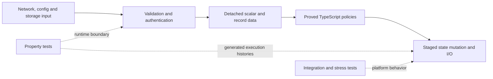

# Formal verification and testing boundaries

Peerborne uses formal verification first, deterministic property testing where
the proof boundary ends, and focused regression/integration tests for behavior
that needs platform execution or a particular attack reproducer. The
[machine-readable strategy](../verification/strategy.json) records why each
property suite is still necessary. This is not a whole-product proof.

LemmaScript checks 39 production functions in 17 proof units. The runtime calls
the actual verified TypeScript; there is no separate executable policy model.
Pure decisions are separated from parsing, authentication, asynchronous commits
and I/O. This makes proof authoring tractable without rewriting the application.

## What is proved

Each claim below is universal within the function's stated input contract and
the pinned toolchain's model. The
[manifest](../verification/formal/manifest.json) names every function, production
consumer, proof obligation and non-vacuity witness.

| Production source                                                           | Functions | Proved behavior                                                                                                                                                                      |
| --------------------------------------------------------------------------- | --------: | ------------------------------------------------------------------------------------------------------------------------------------------------------------------------------------ |
| [Work budget](../packages/core/src/policy/work-budget.ts)                   |         1 | Reservation succeeds iff it fits; accepted addition stays within the budget and safe-integer domain.                                                                                 |
| [BeeKEM transitions](../packages/core/src/policy/beekem-transition.ts)      |         2 | Exact stale/duplicate/conflicting/next/skipped generation classification and bounded append-only leaf counts.                                                                        |
| [Quorum](../packages/core/src/policy/quorum.ts)                             |         3 | Strict-majority default, explicit trust floor, and exactly one qualifying digest bucket; ambiguous or absent winners are rejected.                                                   |
| [Authority votes](../packages/core/src/policy/authority-votes.ts)           |         2 | Exactly the first vote per authority is eligible; differing digests from that authority imply equivocation.                                                                          |
| [Capabilities](../packages/core/src/capabilities.ts)                        |         4 | Exact hierarchy, reflexivity/transitivity, orthogonal history access, field-prefix recognition, resource-bound attenuation and rejection of the first unauthorized child capability. |
| [Membership collections](../packages/core/src/policy/string-collections.ts) |         5 | Duplicate detection, exact missing-frontier count, distinct membership equality, and exact success conditions for initial and accepted invitation roles.                             |
| [Keychain order](../packages/core/src/policy/keychain-order.ts)             |         3 | Entry equality, exact prefix recognition, prefix transitivity and first rewrite detection.                                                                                           |
| [Maintenance admission](../packages/core/src/policy/maintenance.ts)         |         3 | Compaction eligibility, authenticated duplicate replacement and first unauthenticated eviction selection.                                                                            |
| [Invitation replay](../packages/core/src/policy/replay-admission.ts)        |         2 | Complete conflict/replay/fresh-admission classification; an identical replay does not consume fresh capacity.                                                                        |
| [Invitation time](../packages/core/src/policy/invitation-time.ts)           |         3 | Expiry, future-skew and minimum processing-window boundaries.                                                                                                                        |
| [Rollback anchor](../packages/core/src/policy/anchor-advance.ts)            |         1 | Exact valid-advance conditions: revision +1, epoch unchanged or +1, same-epoch control-head binding and terminal poison.                                                             |
| [Retention](../packages/core/src/policy/retention.ts)                       |         1 | A CID is selected iff it is a candidate and is neither retained nor protected. This includes completeness, not just exclusion.                                                       |
| [Base64 sizing](../packages/core/src/policy/encoded-size.ts)                |         2 | Exact block sizing and padding upper bounds in the uint32 input domain.                                                                                                              |
| [Query expansion](../packages/index/src/query-budget.ts)                    |         1 | Exact bounded Cartesian size before allocation; rejection iff the product exceeds the limit.                                                                                         |
| [UTF-16 scanner](../packages/core/src/internal/canonical-encoding.ts)       |         4 | A string is accepted iff every surrogate code unit has its matching adjacent partner.                                                                                                |
| [Bootstrap selection](../packages/core/src/bootstrap-config.ts)             |         1 | Bootstrap mode iff the configured peer list is nonempty.                                                                                                                             |
| [React cache key](../packages/react/src/hooks-cache.ts)                     |         1 | Exact concatenation and path recovery; injectivity for a fixed namespace.                                                                                                            |

The capability tables are frozen to preserve the constant-model assumption.
Numeric contracts bound arithmetic to domains where JavaScript executes the
proved integer arithmetic exactly. Callers still have to supply validated,
detached values. A proof of a pure decision does not authenticate its inputs,
make its commit atomic, establish storage durability or prove eventual progress.
The cache-key proof does not prove WeakMap identity or namespace allocation.

The [feature audit](feature-audit.md) remains authoritative about product gaps.
For example, safe epoch-fork rejection is not automatic fork reconciliation;
capability implication does not establish field-level enforcement on the
document mutation path. None of these proofs establishes forward secrecy,
post-compromise security, key erasure or cryptographic unforgeability.

## Property testing after proofs

The inventory audits 24 property-suite files containing 50 explicit
`fast-check` assertions across all six library packages. Seeds and workload
bounds are checked in; generated operation histories shrink on failure. Counts
are declarations, not code coverage or a security percentage. Parameterized
properties can invoke the same assertion more than once.

| Unproved boundary                       | Generated evidence                                                                                                                                                                                     |
| --------------------------------------- | ------------------------------------------------------------------------------------------------------------------------------------------------------------------------------------------------------ |
| JavaScript number/string/byte semantics | Native UTF-16 calibration, BigInt sizing/quorum oracles, byte ownership, chunked framing, invalid work-counter rollback and bounded tree arithmetic.                                                   |
| Reflection and parser defenses          | Wire fuzzers, accessor/cycle rejection and detached snapshots.                                                                                                                                         |
| Mutable caches and bounded buffers      | Independent LRU and Welcome-buffer models, eviction, staged finalization and producer/consumer ownership.                                                                                              |
| Asynchronous lifecycle                  | FIFO exclusion, failure recovery, onboarding coalescing, reverse startup cleanup, encrypted store transactions, rollback and outbox ownership.                                                         |
| Cryptographic adapters                  | AES round trips and tampering, signed UCAN delegation chains and signed resource/privilege/lifetime escalation attempts. These are integrity checks, not secrecy proofs.                               |
| CRDT dependencies                       | Automerge/Yjs concurrent set/delete and string/object schema changes, reordered and duplicate deltas, missing ancestry, late replicas, snapshot recovery and per-actor witnesses.                      |
| Query/index behavior                    | Memory and IndexedDB execution against a separate full-scan oracle, nested predicates, finite numeric ordering, cursor binding, pagination and reopen; generated field traversal and Bloom merge laws. |
| UI identity and state                   | React instance/cache isolation, Redux histories against a Map oracle, prior-state immutability, prototype-sensitive IDs and state-selector identity.                                                   |
| Mutable statistics                      | Counters, event aggregation and reset against independently calculated totals.                                                                                                                         |

Native cryptographic entropy is not mocked; generated data and schedules have
fixed seeds. These suites run in the existing `yarn test` CI job. The formal CI
job also audits selection registration, property seeds/run bounds and the
strategy catalog. Reports contain source metadata and synthetic workloads,
never live keys or document data.

Generated histories exposed two runtime bugs during this expansion:

- An onboarding result of `undefined` was treated as a cache miss, repeating
  a completed request. Cache presence is now checked independently of its value.
- A Redux document ID of `__proto__` changed the document table's prototype,
  while inherited names could be mistaken for open documents. Own-property
  checks and computed-property writes preserve them as ordinary document IDs.

The smallest reproductions remain explicit examples in the corresponding
property suites. Bootstrap example tests and capability-hierarchy example
tables were removed because their laws are now proved. Regex parsing,
signature, rollback, serialization, browser and attack regressions remain
where they check behavior outside the contracts.

## Cost and remaining work

The 39-function proof check takes roughly 40–55 seconds on the development host;
the report records actual duration, source/proof hashes and tool versions.
Controls run separately. First-time setup downloads the compiler dependencies
and a roughly 55–65 MB Dafny distribution. Specification review, proof authoring
and JavaScript/model correspondence dominate cost; repeated checks are cheap.
Host timing is an observation, not a cross-machine performance guarantee.

The source inventory contains roughly 59,000 physical first-party TypeScript
lines, 2,500 function bodies including callbacks, and 1,000 await expressions.
Run `yarn verify:formal:inventory` for current counts and remaining top-level
functions. These structural measurements do not identify pure code or measure
semantic coverage.

| Surface                                                      | Appropriate next step                                                                                                                                                                                            |
| ------------------------------------------------------------ | ---------------------------------------------------------------------------------------------------------------------------------------------------------------------------------------------------------------- |
| Supported pure policies and bounded algorithms               | Extend contracts and loop invariants on production functions; retain closed call graphs and non-vacuity witnesses.                                                                                               |
| Native reflection, bitwise hashing and third-party engines   | Keep independent generated oracles and malformed-input checks until those semantics can be modeled faithfully.                                                                                                   |
| Async commits, cancellation, retries and recovery            | Property-test controlled schedules and failures; use integration tests for actual persistence/transport. Sequential function proofs do not establish arbitrary-schedule liveness.                                |
| Cryptographic protocol traces and compromise                 | An explicit protocol model, for example [Tamarin](https://tamarin-prover.com/manual/master/book/001_introduction.html), would add different evidence with its own assumptions and implementation correspondence. |
| WebRTC/libp2p, real IndexedDB, NAT/relay and browser budgets | Retain browser/integration/stress CI and measured diagnostic scenarios. Fake IndexedDB is not browser durability evidence.                                                                                       |

A wholesale rewrite would add risk without removing the dependency and platform
boundaries. Continue extracting cohesive decisions when a concrete invariant
justifies it; do not weaken contracts or replace unsupported operations with
assumed helpers to increase a proof count.

## Toolchain and trust

LemmaScript is a tech preview with a
[supported subset](https://docs.lemmascript.org/subset/), not a verifier for
arbitrary JavaScript. Its pinned
[numeric model](https://github.com/midspiral/LemmaScript/blob/f245e9878aa23a3c4a2d3f75ade4a44cebd545dc/SPEC.md)
does not model IEEE-754 rounding, NaN, Infinity or int32 wraparound. UTF-16
strings and safe slicing are explicitly selected; Unicode-scalar semantics
would be wrong for general JavaScript keys.

Imported helpers can become body-less assumed contracts in emitted Dafny.
Selected call graphs are therefore closed within each proof unit, and Dafny's
assumption audit must find zero escapes. Generated implementation lines cannot
be edited in proof additions. Domain witnesses guard against contradictory
preconditions. Deliberate semantic mutations must reach the verifier and fail
an obligation; a parser or generated-drift failure is insufficient.

A proof replaces tests only for the same property, implementation, model and
preconditions. Runtime adapters, compiler behavior, native APIs, dependencies
and integration assumptions still need evidence, and specifications still need
review. See the [formal workflow](../verification/formal/README.md) to reproduce
the checks and inspect their exact scope.
