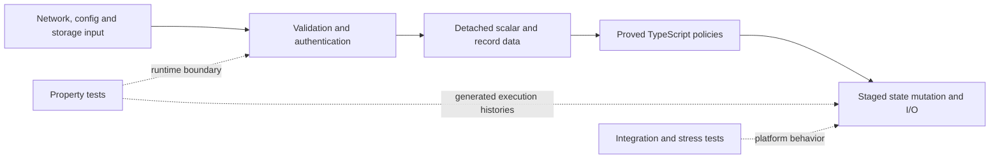

# Formal verification and testing boundaries

Peerborne uses formal verification first, deterministic property testing where
the proof boundary ends, and focused regression/integration tests for behavior
that needs platform execution or a particular attack reproducer. The
[machine-readable strategy](../verification/strategy.json) records why each
property suite is still necessary. This is not a whole-product proof.

LemmaScript checks 147 production functions in 37 proof units. The runtime calls
the actual verified TypeScript; there is no separate executable policy model.
Pure decisions are separated from parsing, authentication, asynchronous commits
and I/O. This makes proof authoring tractable without rewriting the application.

## What is proved

Each claim below is universal within the function's stated input contract and
the pinned toolchain's model. The
[manifest](../verification/formal/manifest.json) names every function, production
consumer, proof obligation and non-vacuity witness.

| Production source                                                           | Functions | Proved behavior                                                                                                                                                                                           |
| --------------------------------------------------------------------------- | --------: | --------------------------------------------------------------------------------------------------------------------------------------------------------------------------------------------------------- |
| [Work budget](../packages/core/src/policy/work-budget.ts)                   |         1 | Reservation succeeds iff it fits; accepted addition stays within the budget and safe-integer domain.                                                                                                      |
| [BeeKEM transitions](../packages/core/src/policy/beekem-transition.ts)      |         2 | Exact stale/duplicate/conflicting/next/skipped generation classification and bounded append-only leaf counts.                                                                                             |
| [Quorum](../packages/core/src/policy/quorum.ts) | 7 | Strict-majority default and explicit trust floor; exact first-eligible peer selection, distinct identities, digest multiplicities, stable cohort projection and failure precedence. Distinct digests cannot both reach a strict majority of the counted votes; ambiguous threshold winners are rejected. |
| [Authority votes](../packages/core/src/policy/authority-votes.ts)           |         2 | Exactly the first vote per authority is eligible; differing digests from that authority imply equivocation.                                                                                               |
| [Capabilities](../packages/core/src/capabilities.ts)                        |         4 | Exact hierarchy, reflexivity/transitivity, orthogonal history access, field-prefix recognition, resource-bound attenuation and rejection of the first unauthorized child capability.                      |
| [Membership collections](../packages/core/src/policy/string-collections.ts) |         5 | Duplicate detection, exact missing-frontier count, distinct membership equality, and exact success conditions for initial and accepted invitation roles.                                                  |
| [Keychain order](../packages/core/src/policy/keychain-order.ts) | 5 | Entry equality, exact prefix recognition, prefix transitivity, first rewrite detection, safe operation-tail clocks and exact complete append-chain ordering with at most N+1 successor probes. |
| [Maintenance admission](../packages/core/src/policy/maintenance.ts)         |         3 | Compaction eligibility, authenticated duplicate replacement and first unauthenticated eviction selection.                                                                                                 |
| [Welcome admission](../packages/core/src/policy/welcome-admission.ts) | 10 | Exact byte accounting, bounded admission and trimming, expiry selection, a monotone observed clock, precise removal and value-map projection/insertion. Checked finite histories preserve retained bindings, count/byte limits, timestamp coherence and trusted-binding provenance. |
| [Invitation replay](../packages/core/src/policy/replay-admission.ts)                       |         9 | Exact conflict classification, coherent bounded join/acceptance indexes, monotone time, expiry-only retirement and sweep frontier. Checked arbitrary finite histories preserve join and consumed acceptance bindings and prevent expired offer revival.                                                  |
| [Invitation time](../packages/core/src/policy/invitation-time.ts)           |         3 | Expiry, future-skew and minimum processing-window boundaries.                                                                                                                                             |
| [Rollback anchor](../packages/core/src/policy/anchor-advance.ts)              |         2 | Exact valid-advance conditions, same-epoch control-head binding, terminal poison, and exact-parent next-epoch authenticated removal admission.                                                                                                                                                           |
| [Retention](../packages/core/src/policy/retention.ts)                       |         1 | A CID is selected iff it is a candidate and is neither retained nor protected. This includes completeness, not just exclusion.                                                                            |
| [Base64 sizing](../packages/core/src/policy/encoded-size.ts)                |         2 | Exact block sizing and padding upper bounds in the uint32 input domain.                                                                                                                                   |
| [Query expansion](../packages/index/src/query-budget.ts)                    |         1 | Exact bounded Cartesian size before allocation; rejection iff the product exceeds the limit.                                                                                                              |
| [UTF-16 and bounded UTF-8](../packages/core/src/internal/canonical-encoding.ts) | 6 | Exact surrogate pairing and UTF-8 prefix-byte counts; acceptance iff the paired string fits the byte cap; bounded scan without encoded buffers and immediate rejection of excessive code-unit length.                                                                                                                     |
| [Bootstrap selection](../packages/core/src/bootstrap-config.ts)             |         1 | Bootstrap mode iff the configured peer list is nonempty.                                                                                                                                                  |
| [React cache key](../packages/react/src/document-cache-key.ts)                     |         1 | Exact concatenation and path recovery; injectivity for a fixed namespace.                                                                                                                                 |
| [Package partition](../packages/core/src/policy/package-partition.ts)       |         4 | Exact pending insertion/removal, irreversible consumption-marker growth, disjoint consume transfer with conserved membership/count, and stable operation-to-record bindings.                              |
| [Store budget and baseline](../packages/core/src/policy/store-budget.ts)    |         3 | Exact framed-byte reservation/release within 128 MiB, safe revision increment, stale-baseline rejection and nondecreasing committed epochs; composition over delta/commit sequences.                      |
| [Commit lifecycle](../packages/core/src/policy/commit-lifecycle.ts)         |         4 | Claims require a current prepared base without active hydration; finalization is absorbing/idempotent, and coordinator admission/recovery preserve fork/poison/error priority.                            |
| [Replay retention](../packages/core/src/policy/replay-window.ts)            |         4 | Exact first gap in the retained interval, monotone uint64 epoch floors, a retained authorization predecessor, and protection of every pending delivery from pruning.                                      |
| [Graph reachability](../packages/core/src/policy/graph-reachability.ts)     |         2 | Exact least successor-closed set containing the root, including cyclic/disconnected graphs; terminating traversal with at most E+1 queued entries and direct ACL-node pruning exclusion.                  |
| [BeeKEM tree indices](../packages/core/src/policy/tree-index.ts)            |        17 | Exact levels, roots, leaf-index inverses, parent/child identities including ragged trees, sibling pairs, bounded path links to the root and matching copaths.                                             |
| [Query order and pages](../packages/index/src/query-order.ts)               |         4 | UTF-16/finite-real scalar order, lazy first-difference/direction/path ordering, symmetry and transitivity under per-field order laws, and exact reconstruction by successive positive-sized prefix pages. |
| [Authentication budget](../packages/core/src/policy/authentication-budget.ts) | 1 | Attempts and bytes are reserved atomically; either both advance exactly or neither changes. Arbitrary finite reservation histories conserve admitted counts and byte totals within both limits. |
| [Control-chain admission](../packages/core/src/policy/control-chain.ts)       |         4 | Exact genesis/update action, contiguous uint64 epoch and parent/head admission, operation-reuse rejection, authenticated self-update admission and error priority; valid epoch sequences do not wrap.                                                                                                    |
| [Journal revision index](../packages/core/src/policy/journal-index.ts) | 1 | Exact retained suffix validity: at most 128 positive contiguous revisions ending at the head, minimum retained-byte accounting and an empty zero-revision/zero-byte index. |
| [Binary frame layout](../packages/core/src/policy/frame-layout.ts) | 3 | Whole-field write admission and finite-history retained-byte/part bounds; field acceptance iff its length and reserved trailer fit, ordered disjoint ranges, bounded chunk copies with positive progress when input and capacity remain, and exact saturation across finite chunk sequences. |
| [Document admission](../packages/core/src/policy/document-admission.ts)       |         4 | Exact count/byte reservation, safe release, terminal preparation phases and success/failure application states. Checked recursive models establish counter bounds and at most one context- and authorization-matching commit across arbitrary finite event histories. |
| [Connection retry](../packages/core/src/policy/connection-retry.ts) | 1 | A retry is admitted exactly when the failure is retryable, cancellation has not occurred and another attempt remains within the configured bound. |
| [Sync response admission](../packages/core/src/policy/sync-request.ts) | 7 | Exact freshness, nondecreasing effective time, expiry-only replay pruning, bounded insertion and response eligibility. Checked finite histories preserve every live nonce and bound the response ledger to 46 entries under the two-second cooldown. |
| [Authority capture](../packages/core/src/policy/authority-capture.ts) | 2 | Exact scalar-roster acceptance, unique identities, required local membership, a 256-entry bound, exact ID/key/role lookup bindings and empty rejection results. |
| [Content admission](../packages/core/src/policy/document-content.ts) | 3 | Exact sequence/parent/replay and role decisions, safe next sequence and finite-history accepted-prefix laws. |
| [Journal recovery and publication ledger](../packages/core/src/policy/document-journal.ts) | 10 | Exact bounded full/recovery read plans, authenticated recovery, strict authority epoch advance, exact accepted-token lookup, fresh bounded insertion, exact pending-token projection, abort-preserving candidate selection and finite-history token provenance. |
| [Journal store transitions](../packages/core/src/policy/journal-store.ts) | 3 | Exact revision/count/byte admission, token/checkpoint-bound commit eligibility, unique bounded outbox append/removal, exact byte totals and retained-index projection. Checked finite histories preserve metadata bounds and accepted prefixes when no checkpoint commits occur. |

Map proofs use immutable map values. Candidate/checkpoint ownership therefore also
has native JavaScript properties: a missing copy can pass the value-model proof
while mutating the active map. A dedicated control verifies an intentionally
aliased variant and confirms that native counterexample. The healthy production
implementation must pass the separate ownership and generated-history properties.

The pending BeeKEM Welcome buffer now uses a complete admission plan before
copying a body or changing retained state. An unverified arrival may replace
neither an existing key nor an authenticated victim. It is rejected if protected
entries alone leave insufficient count or byte capacity; partial evictions are
not committed. Authenticated arrivals can evict unverified entries first and
then the oldest remaining entries. Every retained value is projected from the
original owned map, and every insertion receives one owned body.

The checked helpers and finite histories establish exact byte accounting,
16-entry/20 MiB production limits, authenticated-binding preservation across
unverified admissions, and provenance of every newly authenticated binding.
Explicit deletion or authenticated replacement/eviction remains allowed.
Minimal-body header eligibility is monotone in body size, so its early check
cannot discard an otherwise admissible body. Pressure passes terminate within
the bounded metadata array; a no-pressure path avoids them.

Native properties exposed loss of authenticated Welcomes under unverified
count/byte floods, truthy nonboolean flags accepted by the raw buffer API,
and unnecessary copying or serialization of already rejected arrivals. The
buffer now validates its native key/flag inputs and prepares its new map before
installing it. Properties also exercise copying/projection/insertion failures,
serializer reentrancy,
detached payloads and native order against an independent ranked-victim BigInt
oracle. The existing receive-path signature checks already enforce strict
verification results; raw-buffer hardening is not a signature-bypass finding.

Expiry pruning now runs on metadata before the replay drain requests a detached
body. The checked plan removes exactly entries whose observed age exceeds the
five-minute TTL, preserving entries at the exact boundary and accounting for
every retained byte. A nondecreasing sampled clock stamps successful arrivals
and pruning passes; rejected stores, malformed clocks and failed preparations
cannot advance it. Checked finite histories compose admission, deletion and
pruning while preserving clock bounds, timestamp/value-map coherence, count
and byte limits, and untouched payload bindings.

Native properties reproduced a replay-body copy for an already expired Welcome.
The production drain now prunes first and checks cancellation before sampling
the clock. Generated histories use an independent BigInt time oracle, including
safe-integer boundaries, backward samples, expiry failures and rejected floods.
Pruning requires an explicit call; clock progress, periodic maintenance and
arbitrary asynchronous replay schedules remain runtime assumptions.

This proof assumes truthful authentication and detached bounded metadata.
Native byte lengths, object/Map identity and alias ownership retain property
checks. Asynchronous replay/draining, durable storage, scheduler liveness and browser
heap/latency limits remain outside the proof. A passing retention model does
not establish document secrecy or delivery across hostile networks.

The invitation guard calls seven additional verified helpers for its four
indexes, effective clock and expiry frontier. Checked arbitrary finite histories
preserve the first join binding and every consumed acceptance, reject revival
after hard expiry, and retain live entries without silently evicting them.
Each index has at most the configured capacity, so all four together retain at
most four times that many bindings (default 1,024 offers, maximum 65,536).
This bounds entry counts, not exact native heap bytes.

The proof uses a fixed digest-to-offer catalog and truthful validation inputs.
Collision resistance and caller signature verification are assumptions; native
properties exercise real signed envelopes and SHA binding separately. The
runtime intentionally mutates four distinct private maps in place, with native
properties checking map identity, record ownership and agreement with an
independent tuple-array history oracle. The expiry frontier proves live traffic
can skip enumeration. Expiry sweeps still take linear work in capacity; the
proof does not establish a main-thread latency bound.

Generated schedules exposed admission after asynchronous hashing crossed the
signed deadline, and replay revival after retirement followed by clock rollback
or settlement of an older pending observation. The guard now rechecks expiry
immediately before recording and maintains a nondecreasing effective clock.
Native properties also exposed full-table scans on live traffic and a writable
runtime capacity despite TypeScript's `readonly`. Live traffic now skips those
scans and the capacity has a nonwritable, nonconfigurable property descriptor.
All guarantees remain local to a guard instance; restarting loses its replay
memory. This does not prove document secrecy or global membership exactly-once
behavior.

The default document runtime uses the sync-response policies before retaining
a request or preparing a response. Freshness allows 60 seconds of past time
and 30 seconds of future skew; retained admissions are separated by at least
two seconds. The checked history model calls the production policies and
derives at most 46 retained entries, even across clock rollback and delayed
settlement. Pruning visits at most 128 entries and preserves each live binding;
the hard capacity guard rejects new entries rather than evicting live ones.
Only response attempts consume replay capacity, so known-state requests and
requests arriving during cooldown cannot flush the replay ledger.
The no-op work check concerns response preparation; pubsub request authentication
still has its own cost and is outside this response-admission bound.
Replay pruning and history insertion use separate checked assertion batches.
CI verifies the complete sync unit under four fixed solver seeds as well as its normal audit
and counterexample controls, without increasing the existing time limits.

The history model assumes truthful authentication and detached inputs. Native
properties exercise real signatures and encryption, Map ownership, malformed
local clocks, strict boolean authorization, future-dated dense request streams,
and controlled delays/failures in verification, signing, encryption and
publication. The registered GossipSub validator authenticates re-encrypted
requests independently of local replay capacity and response history. Local
expiry returns `Ignore`; malformed or unauthenticated requests can return
`Reject`. Response admission remains in the handler, so answering a request
does not turn an honest forwarder's valid copy into a penalizable message.
The runtime rechecks freshness after verification and immediately
before handing ciphertext to pubsub, and starts the next cooldown at preparation
settlement, including failures. Replay protection is per document instance;
the proof does not establish durable replay protection across restarts. The
response still holds the document mutation queue while preparing and publishing,
so this is a logical work/storage bound, not a main-thread latency, cryptographic
secrecy or eventual-delivery proof.

The [document-authority policy](../packages/core/src/policy/document-authority.ts)
adds five verified production functions, with a shared bounded field validator
checked in the same unit. A valid detached roster has 1–256
members, distinct member IDs and public keys, valid roles and exactly one
controller. Controller bindings accept only fresh heads within the 1,024-record
history bound. A checked finite-history method preserves every old head/controller
binding, excludes heads introduced only by unsigned attempts, and retains an
admitted first transition through subsequent hostile attempts.

The history proof takes correct current-controller authentication as an input;
it does not prove signatures or group membership. Map values do not model native
object identity, byte ownership, parsing or asynchronous preparation. Generated
properties check these boundaries, including races between signed updates and
signed restoration attempts that reuse an older control head. The latter was
accepted by the previous implementation and could replace its historical
controller binding; restoration and live validation now reject it.

The shared bounded UTF-8 preflight now counts bytes without constructing an
encoded buffer. Checked prefix sums strengthen the generated method's contract:
it accepts exactly paired UTF-16 whose UTF-8 weight fits the byte cap and returns
that exact count. Oversized code-unit lengths reject before scanning. The loop
variant and index invariant bound the scan by the configured byte cap. The
prefix-sum functions, lemmas and strengthening annotations are proof additions;
the runtime implementation remains iterative.

Load challenges, trusted load commitments and response manifests use this
preflight before UTF-8 allocation. Manifest root and snapshot scalar metadata
are validated before graph capture, payload copying or change serialization.
Native properties reproduced late snapshot validation and encoding oversized
text before rejection. They exercise native encoder agreement, character-read
counts, rejection copy/serializer costs, signature/hash bytes, ownership and
mutation during serializer callbacks. TextEncoder and UTF-16 runtime semantics,
safe-integer/type guards, complete pipeline ordering and cryptography remain
native boundaries. These checks do not establish VM heap or UI latency bounds,
nor end-to-end load security.

The binary writer uses a checked planner to reserve a complete fixed or
length-prefixed field before copying its payload. Rejected writes preserve the
previous offset and retain no prefix or payload. Accepted fields own their
payload once and retain only non-empty parts. Checked finite histories bound
retained payload bytes and part counts by the encoded byte budget, with exact
payload/prefix accounting even when an admitted native copy fails before commit.
Native copy success is a proof input; the proof does not establish allocation
success or VM exception behavior.

The [writer properties](../packages/core/src/document-writer-properties.test.ts)
reproduced partial prefixes after capacity rejection, duplicate payload copies,
and unbounded retained empty parts outside the byte budget. They check actual
copy counts, retained-part calibration, generated write/rejection histories,
injected copy failures, malformed limits, canonical prefix bytes, ownership and
shared/detached byte views. This bounds retained content and part counts, not
transient allocations, TextEncoder work, output materialization, native heap
overhead or UI latency. No remote exploit was established by these utility-level
failures.

The journal read planner now drives the built-in IndexedDB snapshot and outbox
queries. Recovery requests every accepted entry, skips pending and publication
bodies, and captures only the pending discard token from head metadata. Full
diagnostic snapshots retain their separate body reads. After accepted-state and
anchor validation, recovery reads each queued publication once. Backends may
provide this recovery-only capability; the required full snapshot API remains
available to other providers.

The checked planner and its composition with the production recovery classifier
bound journal row gets to 129 for the initial recovery snapshot and 147 including
outbox reads and a pending-token cleanup. A rejected state or failed required
anchor advance triggers no publication-payload gets in the model. Compared with
the former full snapshot path, it saves exactly one body get per queued
publication and per pending entry in the initial metadata. The composition allows
the later outbox metadata to differ. Counts exclude writes, anchor-provider I/O,
cryptographic work and browser-internal operations. Authentication and anchor
results are trusted proof inputs; they are exercised separately with native
crypto and storage properties.

Native properties reproduced duplicate publication reads, eager body reads before
failed validation, and accepted recovery blocked by missing or corrupt unaccepted
pending bodies. New properties check actual IndexedDB requests and transaction
scopes, pending-body disposal without replay, full/recovery field ownership,
receiver-bound capability dispatch and mutation during anchor awaits. Neither
these checks nor the I/O model proves UI latency, physical erasure, browser heap
bounds or recovery after losing both accepted storage and its independent anchor.

The [journal index policy](../packages/core/src/policy/journal-index.ts) validates
retained revision metadata before requesting any entry rows. Checkpoint suffixes
may start above revision one; every subsequent revision must be contiguous and
the suffix must end at the stored head. Empty indexes have zero revision and zero
bytes, and retained indexes contain at most 128 rows with coherent minimum bytes.

IndexedDB row copying now calls the existing verified `boundedFieldEnd` policy
before allocating an owned ciphertext copy. Accepted-entry reads share one
remaining-byte budget from the validated head. Pending and publication rows must
match their indexed sizes exactly; an isolated head read cannot exceed the
retained-byte total. Checked finite-history methods preserve exact admitted-byte
sums, positive copy sizes, the first rejected position and an absorbing failure.
A bounded-batch corollary limits admitted rows to 128. Both this unit and the index
unit run under four fixed solver seeds.

Native properties reproduced copying past the declared retained total, oversized
head/pending reads accepted by the store, and publication copies made before size
mismatches were rejected. They exercise corrupt and valid IndexedDB records,
request/copy counts, pre-read gap rejection and real encrypted replay. Replay now
reuses its detached captured entries, removing the second outer journal-entry
copy while still isolating provider-byte mutations during an anchor await.

These are storage-boundary and allocation-cost guarantees. The proof assumes
valid native scalar inputs and correct callback/abort behavior. IndexedDB's own
structured cloning, parser/decryption buffers, JavaScript heap totals, UI latency,
cryptographic correctness and anchor honesty remain outside the model.

The [authority-capture policy](../packages/core/src/policy/authority-capture.ts)
checks the scalar roster that the coordinated document actually uses. Acceptance
is equivalent to valid ID/key lengths, valid roles, unique IDs and presence of the
local member. Successful maps contain exactly the original entries, with at most
256 bindings; failures expose no partial roster. The existing custom-provider
policy permits roles 1–3 and public keys up to 16,384 UTF-16 units. The signed
history validator above intentionally has its own stricter roster requirements.

Native properties found that replacing a captured lease's `isCurrent` method
during signing could bypass the original guard's rejection. The runtime now
captures that function once with its original receiver, including across remote
verification, activation and public-key conversion. Properties also reproduced
execution of overridable typed-array `slice` and array iterator methods. The
adapter now snapshots required own data properties, uses intrinsic byte copies
and reads at most 256 own indexed entries without invoking those methods.

Detached bytes/scalars, independent native maps, strict boolean guard results,
accessor/inherited-field rejection and malformed/boundary rosters retain generated
checks against an independent tuple oracle. Immutable proof records assume owned
inputs. The proof does not establish provider honesty, proxy isolation,
cryptographic correctness, asynchronous scheduling or a UI-latency bound. These
are provider-boundary findings; no remote exploit has been established.

The coordinator uses these admission policies for bounded document preparation
and incoming membership deliveries. Document preparation runs outside the
membership queue; finalization rechecks the protected anchor and complete
captured group/control context inside that queue, then requires a pure
synchronous guard to confirm that preparation's authorization is still current.
Identity or role changes therefore need not wait for a rekey to invalidate
prepared work. Signature verification for
incoming membership deliveries starts outside it, using a private one-use
authentication certificate for the owned record. The verifier is checked again
at adoption because application trust can change; causal authorization and state
adoption remain serialized. The native certificate, scheduling, protected storage and actual
context comparisons are property/integration boundaries, not proved by the
scalar policies or the recursive phase model.

The generated suites cover cancellation without premature credit release,
producer and preparation-context mutation, metadata-only outbox progress,
rekey/removal/fork invalidation, shared limits, aliased decoder outputs, native
byte views, current-authorization changes, opaque finalizer failures,
single-capture proxy fields, resizable backing buffers, and conservative
quarantine when native promise settlement cannot be safely observed.
Preparation and all admission verifier/authorizer callbacks use the same
settlement observer, including historical revalidation during adoption;
prototype-proxy promises and suppressed caller abort events have execution
regressions. These JavaScript platform behaviors remain outside the phase proof.
Boxed non-boolean signature and authorization results are rejected without
activating thenable hooks, including before an asynchronous verifier return.
Generated consecutive-epoch schedules also check arrival-order adoption when
later authentication completes first, while document work continues independently.
Node/Chromium MLS checks exercise a
fixture-only AES-GCM/Ed25519 content envelope, cross-document replay, a reader
forging a writer message, tampering, rekey retry, credential revocation without
rekey, and removal during preparation.
The seam is now consumed by the opt-in [coordinated document runtime](coordinated-document-security.md),
which supplies a production content format, signed controller/role history and
device-key encrypted content journal. Native MLS checks also exercise the actual
Automerge/Yjs document APIs over simulated pubsub. Provider cryptography, native
CRDT behavior, callback correctness and physical storage remain runtime/trust
boundaries; this is not a cryptographic secrecy or network-liveness proof.

The capability tables are frozen to preserve the constant-model assumption.
Numeric contracts bound arithmetic to domains where JavaScript executes the
proved integer arithmetic exactly. Callers still have to supply validated,
detached values. A proof of a pure decision does not authenticate its inputs,
make its commit atomic, establish storage durability or prove eventual progress.
The cache-key proof does not prove WeakMap identity or namespace allocation.

The quorum tally proves the exact multiplicity of every digest, including
zero for absent digests, against a checked recursive occurrence count. The
first-eligible selector credits each transport identity once without letting
an unusable earlier entry consume its slot. The cohort selector returns
exactly the agreeing candidate positions in their original order. A separate
checked lemma establishes that distinct digests cannot both reach a strict
majority of the counted votes. Signing-authority deduplication and equivocation
remain distinct from transport-identity deduplication.

Native properties cover map insertion order, hash buffers and offsets,
reflection, malformed/shared-memory responses, authority attribution and
reordered Promise completions against an independent tally. Candidate object
references and IDs are captured before multi-peer probes start; later edits
to the caller's array cannot substitute unprobed objects into the cohort.
This does not freeze arbitrary peer objects or authenticate callbacks. The
orchestrator still relies on the probe callback to verify signatures and trust.

The additional algorithm domains match the runtime guards: at most 32,768
node occurrences and 131,072 edges for graph input; at most 2^30 BeeKEM leaves
(indices through 2^31-2); at most eight query sort fields; and replay windows
from 1 through 65,535 over uint64 epochs. Graph proofs use exact set/edge
accounting; they bound logical queue entries, not engine bytes or wall time.
The native tree adapter rejects object cycles before constructing the detached
graph, while the graph kernel itself supports cycles and duplicate edges.

Tree exponentiation uses a frozen 32-entry exact power table. Local arithmetic
lemmas split the 31 supported levels into finite cases while quantifying over
all valid indices and bounds; these are proofs, not sampled tree tests. All
helper lemmas have checked bodies and pass the same zero-assumption audit.
Scalar arithmetic is isolated in a proof module with a checked bridge to the
emitted arithmetic. CI also verifies the complete tree unit under four fixed
solver seeds to catch sensitivity to solver heuristics.
The recursion measure establishes at most 30 path steps, so the runtime no
longer allocates defensive visited sets for supported BeeKEM traversals.

Package maps are copied on update within their existing table bounds. The
partition laws concern the map transitions; encrypted-byte ownership, native
Map behavior, transaction queues and callback execution remain runtime checks.
Commit claims do not prove that publication callbacks cannot fail or reenter.
The coordinator proof covers recovery/admission decisions and replay retention,
not the whole asynchronous recovery protocol or durable exactly-once delivery.
The ACL pruning predicate protects an ACL node directly; descendant copying and
reattachment remain covered by the existing document integration regressions.

Query proofs assume a pure stable per-field comparator with results -1, 0 or 1.
The transitivity composition explicitly requires the per-field order laws;
it does not establish arbitrary user callbacks. Finite native numbers embed
into the real-order model for comparisons only. NaN/Infinity rejection,
field normalization, cursor decoding/binding and IndexedDB ordering still need
runtime evidence. Prefix-page reconstruction assumes a fixed ordered input;
it is not a claim of snapshot isolation while documents change between pages.

Authentication reservation is a sequential arithmetic proof; shared-budget
execution, authority lookup, abort signals and verification callbacks remain
runtime boundaries. Control-chain admission assumes already validated uint64
epochs and a truthful parent-equality result. The proofs do not establish
signature validity, authorizer correctness or the asynchronous chain's fork
latch. Signed generated histories check those adapters, including callback
failures, unauthorized same-slot candidates and concurrent duplicates/forks.

Frame layout uses uint32 field lengths and safe-integer chunk availability.
The range theorem reserves the following fields before accepting an earlier
one; it does not validate magic, endianness, canonical bytes or signatures.
The copy theorem counts logical bytes, not allocations or wall time. Native
properties check DataView lengths, nonzero byte offsets, hostile length
prefixes, detached results and asynchronous iterator cleanup. The real
Uint8ArrayList dependency runs in a native Node/tsx fixture invoked by Jest;
the inventory audits its fixed seed and run bound along with the TS suites.
Invitation framing reads one message and checks suffixes in the current chunk;
it does not wait for transport EOF to reject data in a future chunk.

The [feature audit](feature-audit.md) remains authoritative about product gaps.
For example, safe epoch-fork rejection is not automatic fork reconciliation;
capability implication does not establish field-level enforcement on the
document mutation path. None of these proofs establishes forward secrecy,
post-compromise security, key erasure or cryptographic unforgeability.

Staged Yjs sessions accept immutable scalar values and shared `Y.Map`, `Y.Array`
and `Y.Text` values. Opaque object/array/binary payloads, embeds with mutable
values, subdocuments and XML child types are rejected before visible application.
These values can change without a parent update event; accepting them would break
the stage-version model. This restriction applies to the new staging capability,
not the existing legacy provider methods. Native regressions cover recursive
preparation, escaped references, native dependency queues, unfinished transactions,
root shared-type preservation and staged checkpoint merge/discard. Native update
bytes do not encode root-type declarations; applications must use the same root
schema on each replica.

The [coordinator-backed document mode](coordinated-document-security.md) calls the
proved content-sequence, role, journal-recovery and epoch-advancement policies
from the production document path. Its new finite-history lemmas establish
monotone content prefixes and journal anchor recovery, with native crypto,
CRDT adapters, IndexedDB and independent anchor conformance checked separately.

The content policy proves exact replay, gap, parent and role admission; the
journal policy proves exact current/single-step/reject recovery and same-group
strict epoch advancement. Inductive histories reject counter rollback and
same-revision substitution at every modeled step. Publication authorization
requires a positive, nonfuture revision and a token bound to that revision by
the authenticated accepted journal. Ledger contracts prove fresh bounded
insertion, exact checkpoint retention and adoption only after anchoring. A
finite-history lemma excludes tokens introduced only by abandoned attempts.
Token generation, native Map ownership, authenticated decoding and storage
readback remain property/integration boundaries.

Yjs keychain history validation now indexes predecessor links and consumes each
reachable item once. The actual ordering helper proves a distinct rooted prefix,
rejects duplicate IDs and predecessor forks, and accepts exactly when a complete
append order exists. Checked prefix uniqueness and a terminal-link certificate
prove completeness as well as rejection. Index construction has at most N loop
iterations; traversal has at most N iterations and N+1 condition probes, including
the final missing successor. The adapter bounds retained entries and items to
1000 and validates operation IDs before forming links. A separate helper proves
exact safe tail-clock arithmetic, calibrated against native BigInt calculations.

The native regression reproduces 499,501 predecessor reads on a valid 1000-actor
history before the change and 1000 afterward. Generated native histories cover
batched appends, permuted actors, merge/export commitments, fork rejection without
publication and fresh validation after in-place edits. Array-oracle properties
calibrate native Map/Set lookup, output ownership and linear element reads.
Yjs decoding/integration, hash-table cost, authentication, total heap usage and
UI latency remain outside these local ordering and abstract work proofs.

## Property testing after proofs

The built-in journal stores share verified staging, commit and publication-index
policies. Outbox additions require a fresh ID and fit both the 16-entry and
16 MiB limits; acknowledgements remove exactly the named ID. The actual planner
has checked exact byte totals, stable projection and empty rejection results.
Finite histories compose staging, matching token/checkpoint commits,
acknowledgements, discards and transaction outcomes. They preserve revision,
retained-entry and outbox bounds, leave accepted entries unchanged on rejection
or aborted transactions, and retain the initial accepted prefix whenever the
history contains no checkpoint commits.

Native properties reproduced duplicate outbox IDs making IndexedDB heads
unreadable, nonboolean checkpoint flags persisting invalid pending metadata,
changed checkpoint flags pruning the in-memory reference store, and repeated
reads of a publication-size getter bypassing its range check. The stores now
validate native scalars before payload copies or write transactions, capture
publication reservations once, and preserve private staged checkpoint metadata.
Generated native histories compare both backends with an independent model;
aborted transactions preserve all indexed and unindexed rows. Actual encrypted
journals recover accepted state after a rejected duplicate and can reuse the ID
after acknowledgement. Storage-commit and payload-match truth remain proof
inputs. The proof does not establish crash durability, cryptographic
unforgeability, arbitrary provider failures, browser heap usage or UI latency.

The inventory audits 60 property-suite files containing 186 explicit
`fast-check` assertions across six library workspaces. Seeds and workload
bounds are checked in; generated operation histories shrink on failure. Counts
are declarations, not code coverage or a security percentage. Parameterized
properties can invoke the same assertion more than once.

| Unproved boundary                       | Generated evidence                                                                                                                                                                                                                          |
| ------------------------------------------------------------ | ---------------------------------------------------------------------------------------------------------------------------------------------------------------------------------------------------------------- |
| JavaScript number/string/byte semantics | Native UTF-16/code-unit calibration, IEEE-754 bit-order oracles, BigInt sizing/quorum/tree oracles, byte ownership, chunked framing and invalid work-counter rollback.                                                                      |
| Reflection and parser defenses          | Wire fuzzers, accessor/cycle rejection, detached snapshots and CID-alias graph adapters against an independent saturation oracle.                                                                                                           |
| Welcome admission and expiry | Native keys/flags/clocks and byte lengths, copy-free expiry, rejected-body copy counts, pre-serialization rejection, preparation failures, serializer reentrancy, cancellation, array/Map ownership and independent ranked-victim/time BigInt oracles. |
| Journal recovery I/O | Native row-get counts and transaction scopes, no pending/publication payload reads before rejected recovery, safe disposal of corrupt unaccepted bodies, distinct snapshot fields and post-await ownership. |
| Journal store transitions | Strict native scalar guards, one-read reservation capture, owned metadata/payload projection, modelled operation histories across both stores, raw-row transaction rollback and encrypted duplicate-rejection recovery. |
| Document binary writes | Whole-field rejection, native copy/part counts, generated write histories, prefix endianness, injected copy failures, malformed limits, detached/shared views and buffer ownership. |
| Load metadata admission | Native UTF-8 agreement and character-read counts, no encoded buffers for rejected text, scalar/root rejection before graph/payload/serializer work, canonical challenge bytes and callback mutation ownership. |
| Yjs keychain history | Native predecessor-read counts, array-oracle Map/Set ordering, owned outputs, BigInt clock arithmetic, batched and permuted actor histories, unchanged commitments after merge/export, fork rejection and revalidation after mutable-document edits. |
| Journal storage reads | Corrupt/valid IndexedDB rows, exact pending/publication sizes, retained-copy budgets, pre-read index rejection, owned-copy counters and native encrypted replay with provider mutation during anchor reads. |
| Authority capture | Native own-data descriptors and indexed-array bounds, intrinsic byte ownership, strict receiver-bound guards across provider awaits, independent maps and a separate scalar tuple oracle. |
| Mutable caches and bounded buffers      | Independent LRU and Welcome-buffer models, eviction, staged finalization and producer/consumer ownership.                                                                                                                                   |
| Asynchronous lifecycle                  | FIFO exclusion, failure recovery, onboarding coalescing, reverse startup cleanup, encrypted store transactions, rollback, one-time package consumption, stable operation bindings, hydration/claim/finalize schedules and outbox ownership. |
| Invitation replay                       | Delayed hashing, expiry retirement/clock rollback, actual signed recipient conflicts, independent tuple-ledger histories, malformed clocks, immutable capacity, native map ownership and live-traffic enumeration counts.                   |
| Cryptographic adapters                  | AES round trips and tampering, signed UCAN delegation chains and signed resource/privilege/lifetime escalation attempts. These are integrity checks, not secrecy proofs.                                                                    |
| CRDT dependencies                       | Automerge/Yjs concurrent set/delete and string/object schema changes, reordered and duplicate deltas, missing ancestry, late replicas, snapshot recovery and per-actor witnesses.                                                           |
| Query/index behavior                    | Memory and IndexedDB execution against a separate full-scan oracle, nested predicates, finite numeric ordering, cursor binding, pagination and reopen; generated field traversal and Bloom merge laws.                                      |
| UI identity and state                   | React instance/cache isolation, Redux histories against a Map oracle, prior-state immutability, prototype-sensitive IDs and state-selector identity.                                                                                        |
| Mutable statistics                      | Counters, event aggregation and reset against independently calculated totals.                                                                                                                                                              |
| Authentication and membership controls | Shared-budget verification and abort schedules, strict callback results, native Ed25519-signed hostile histories, non-poisoning unauthorized forks, queued input snapshots and concurrent duplicate/fork delivery. |
| Binary transition framing | BigInt arithmetic calibration, strict field/trailer limits, malformed lengths, truncation/suffix rejection, byte ownership and actual Uint8ArrayList chunk fragmentation. |

Native cryptographic entropy is not mocked; generated data and schedules have
fixed seeds. These suites run in the existing `yarn test` CI job. The formal CI
job also audits selection registration, property seeds/run bounds and the
strategy catalog. Reports contain source metadata and synthetic workloads,
never live keys or document data.

Generated histories exposed two runtime bugs during this expansion:

- An onboarding result of `undefined` was treated as a cache miss, repeating
  a completed request. Cache presence is now checked independently of its value.
- A Redux document ID of `__proto__` changed the document table's prototype,
  while inherited names could be mistaken for open documents. Own-property
  checks and computed-property writes preserve them as ordinary document IDs.

The smallest reproductions remain explicit examples in the corresponding
property suites. Bootstrap example tests and capability-hierarchy example
tables were removed because their laws are now proved. Regex parsing,
signature, rollback, serialization, browser and attack regressions remain
where they check behavior outside the contracts.

Quorum properties also exposed two runtime bugs: a caller could replace the
peer array during a delayed probe round and receive unprobed replacement
objects in the winning cohort, and rejected probe error names/messages were
copied into logs. The round now projects only its captured candidates and
emits fixed failure diagnostics without inspecting rejected error objects.
Generated schedules preserve the reproductions; these are local orchestration
findings, not evidence of a remote exploit or a complete loader proof.

## Cost and remaining work

The generated report records each full proof run's duration, configured
solver-seed checks, source/proof hashes and tool versions.
CI runs proofs and controls in parallel, with the original gate requiring both
to succeed. This preserves all healthy-program and counterexample checks
without increasing solver limits. Controls can also run separately locally.
First-time setup downloads the compiler dependencies and a roughly 55–65 MB
Dafny distribution. Specification review, proof authoring
and JavaScript/model correspondence dominate cost; repeated checks are cheap.
Host timing is an observation, not a cross-machine performance guarantee.

The source inventory contains roughly 60,000 physical first-party TypeScript
lines, 2,500 function bodies including callbacks, and 1,000 await expressions.
Run `yarn verify:formal:inventory` for current counts and remaining top-level
functions. These structural measurements do not identify pure code or measure
semantic coverage.

| Surface                                                      | Appropriate next step                                                                                                                                                                                            |
| ------------------------------------------------------------ | ---------------------------------------------------------------------------------------------------------------------------------------------------------------------------------------------------------------- |
| Supported pure policies and bounded algorithms               | Extend contracts and loop invariants on production functions; retain closed call graphs and non-vacuity witnesses.                                                                                               |
| Native reflection, bitwise hashing and third-party engines   | Keep independent generated oracles and malformed-input checks until those semantics can be modeled faithfully.                                                                                                   |
| Async commits, cancellation, retries and recovery            | Property-test controlled schedules and failures; use integration tests for actual persistence/transport. Sequential function proofs do not establish arbitrary-schedule liveness.                                |
| Cryptographic protocol traces and compromise                 | An explicit protocol model, for example [Tamarin](https://tamarin-prover.com/manual/master/book/001_introduction.html), would add different evidence with its own assumptions and implementation correspondence. |
| WebRTC/libp2p, real IndexedDB, NAT/relay and browser budgets | Retain browser/integration/stress CI and measured diagnostic scenarios. Fake IndexedDB is not browser durability evidence.                                                                                       |

A wholesale rewrite would add risk without removing the dependency and platform
boundaries. Continue extracting cohesive decisions when a concrete invariant
justifies it; do not weaken contracts or replace unsupported operations with
assumed helpers to increase a proof count.

## Toolchain and trust

LemmaScript is a tech preview with a
[supported subset](https://docs.lemmascript.org/subset/), not a verifier for
arbitrary JavaScript. Its pinned
[numeric model](https://github.com/midspiral/LemmaScript/blob/f245e9878aa23a3c4a2d3f75ade4a44cebd545dc/SPEC.md)
does not model IEEE-754 rounding, NaN, Infinity or int32 wraparound. UTF-16
strings and safe slicing are explicitly selected; Unicode-scalar semantics
would be wrong for general JavaScript keys.

Imported helpers can become body-less assumed contracts in emitted Dafny.
Selected call graphs are therefore closed within each proof unit, and Dafny's
assumption audit must find zero escapes. Generated implementation lines cannot
be edited in proof additions. Domain witnesses guard against contradictory
preconditions. Deliberate semantic mutations must reach the verifier and fail
an obligation; a parser or generated-drift failure is insufficient.

The pinned compiler has an ordered map-index expression limitation documented
in the formal workflow. Accepted ordered map-index comparisons keep the lookup
on the left. A separate audited calibration checks all four supported operators
against scalar comparisons. Contract translation remains part of the trusted
toolchain and requires review of the emitted program.

A proof replaces tests only for the same property, implementation, model and
preconditions. Runtime adapters, compiler behavior, native APIs, dependencies
and integration assumptions still need evidence, and specifications still need
review. See the [formal workflow](../verification/formal/README.md) to reproduce
the checks and inspect their exact scope.
