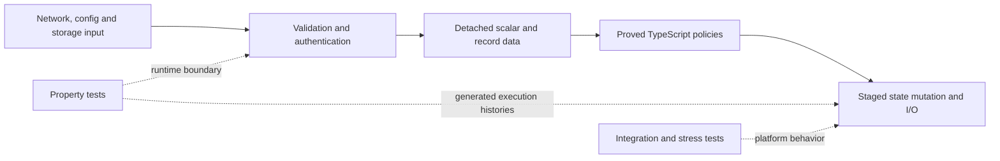

# Formal verification and testing boundaries

Peerborne uses formal verification first, deterministic property testing where
the proof boundary ends, and focused regression/integration tests for behavior
that needs platform execution or a particular attack reproducer. The
[machine-readable strategy](../verification/strategy.json) records why each
property suite is still necessary. This is not a whole-product proof.

LemmaScript checks 92 production functions in 28 proof units. The runtime calls
the actual verified TypeScript; there is no separate executable policy model.
Pure decisions are separated from parsing, authentication, asynchronous commits
and I/O. This makes proof authoring tractable without rewriting the application.

## What is proved

Each claim below is universal within the function's stated input contract and
the pinned toolchain's model. The
[manifest](../verification/formal/manifest.json) names every function, production
consumer, proof obligation and non-vacuity witness.

| Production source                                                           | Functions | Proved behavior                                                                                                                                                                                           |
| --------------------------------------------------------------------------- | --------: | --------------------------------------------------------------------------------------------------------------------------------------------------------------------------------------------------------- |
| [Work budget](../packages/core/src/policy/work-budget.ts)                   |         1 | Reservation succeeds iff it fits; accepted addition stays within the budget and safe-integer domain.                                                                                                      |
| [BeeKEM transitions](../packages/core/src/policy/beekem-transition.ts)      |         2 | Exact stale/duplicate/conflicting/next/skipped generation classification and bounded append-only leaf counts.                                                                                             |
| [Quorum](../packages/core/src/policy/quorum.ts) | 7 | Strict-majority default and explicit trust floor; exact first-eligible peer selection, distinct identities, digest multiplicities, stable cohort projection and failure precedence. Distinct digests cannot both reach a strict majority of the counted votes; ambiguous threshold winners are rejected. |
| [Authority votes](../packages/core/src/policy/authority-votes.ts)           |         2 | Exactly the first vote per authority is eligible; differing digests from that authority imply equivocation.                                                                                               |
| [Capabilities](../packages/core/src/capabilities.ts)                        |         4 | Exact hierarchy, reflexivity/transitivity, orthogonal history access, field-prefix recognition, resource-bound attenuation and rejection of the first unauthorized child capability.                      |
| [Membership collections](../packages/core/src/policy/string-collections.ts) |         5 | Duplicate detection, exact missing-frontier count, distinct membership equality, and exact success conditions for initial and accepted invitation roles.                                                  |
| [Keychain order](../packages/core/src/policy/keychain-order.ts)             |         3 | Entry equality, exact prefix recognition, prefix transitivity and first rewrite detection.                                                                                                                |
| [Maintenance admission](../packages/core/src/policy/maintenance.ts)         |         3 | Compaction eligibility, authenticated duplicate replacement and first unauthenticated eviction selection.                                                                                                 |
| [Invitation replay](../packages/core/src/policy/replay-admission.ts)        |         2 | Complete conflict/replay/fresh-admission classification; an identical replay does not consume fresh capacity.                                                                                             |
| [Invitation time](../packages/core/src/policy/invitation-time.ts)           |         3 | Expiry, future-skew and minimum processing-window boundaries.                                                                                                                                             |
| [Rollback anchor](../packages/core/src/policy/anchor-advance.ts)              |         2 | Exact valid-advance conditions, same-epoch control-head binding, terminal poison, and exact-parent next-epoch authenticated removal admission.                                                                                                                                                           |
| [Retention](../packages/core/src/policy/retention.ts)                       |         1 | A CID is selected iff it is a candidate and is neither retained nor protected. This includes completeness, not just exclusion.                                                                            |
| [Base64 sizing](../packages/core/src/policy/encoded-size.ts)                |         2 | Exact block sizing and padding upper bounds in the uint32 input domain.                                                                                                                                   |
| [Query expansion](../packages/index/src/query-budget.ts)                    |         1 | Exact bounded Cartesian size before allocation; rejection iff the product exceeds the limit.                                                                                                              |
| [UTF-16 scanner](../packages/core/src/internal/canonical-encoding.ts)       |         4 | A string is accepted iff every surrogate code unit has its matching adjacent partner.                                                                                                                     |
| [Bootstrap selection](../packages/core/src/bootstrap-config.ts)             |         1 | Bootstrap mode iff the configured peer list is nonempty.                                                                                                                                                  |
| [React cache key](../packages/react/src/hooks-cache.ts)                     |         1 | Exact concatenation and path recovery; injectivity for a fixed namespace.                                                                                                                                 |
| [Package partition](../packages/core/src/policy/package-partition.ts)       |         4 | Exact pending insertion/removal, irreversible consumption-marker growth, disjoint consume transfer with conserved membership/count, and stable operation-to-record bindings.                              |
| [Store budget and baseline](../packages/core/src/policy/store-budget.ts)    |         3 | Exact framed-byte reservation/release within 128 MiB, safe revision increment, stale-baseline rejection and nondecreasing committed epochs; composition over delta/commit sequences.                      |
| [Commit lifecycle](../packages/core/src/policy/commit-lifecycle.ts)         |         4 | Claims require a current prepared base without active hydration; finalization is absorbing/idempotent, and coordinator admission/recovery preserve fork/poison/error priority.                            |
| [Replay retention](../packages/core/src/policy/replay-window.ts)            |         4 | Exact first gap in the retained interval, monotone uint64 epoch floors, a retained authorization predecessor, and protection of every pending delivery from pruning.                                      |
| [Graph reachability](../packages/core/src/policy/graph-reachability.ts)     |         2 | Exact least successor-closed set containing the root, including cyclic/disconnected graphs; terminating traversal with at most E+1 queued entries and direct ACL-node pruning exclusion.                  |
| [BeeKEM tree indices](../packages/core/src/policy/tree-index.ts)            |        17 | Exact levels, roots, leaf-index inverses, parent/child identities including ragged trees, sibling pairs, bounded path links to the root and matching copaths.                                             |
| [Query order and pages](../packages/index/src/query-order.ts)               |         4 | UTF-16/finite-real scalar order, lazy first-difference/direction/path ordering, symmetry and transitivity under per-field order laws, and exact reconstruction by successive positive-sized prefix pages. |
| [Authentication budget](../packages/core/src/policy/authentication-budget.ts) | 1 | Attempts and bytes are reserved atomically; either both advance exactly or neither changes. Arbitrary finite reservation histories conserve admitted counts and byte totals within both limits. |
| [Control-chain admission](../packages/core/src/policy/control-chain.ts)       |         4 | Exact genesis/update action, contiguous uint64 epoch and parent/head admission, operation-reuse rejection, authenticated self-update admission and error priority; valid epoch sequences do not wrap.                                                                                                    |
| [Binary frame layout](../packages/core/src/policy/frame-layout.ts) | 2 | Field acceptance iff its length and reserved trailer fit, ordered disjoint ranges, bounded chunk copies with positive progress when input and capacity remain, and exact saturation across finite chunk sequences. |
| [Document admission](../packages/core/src/policy/document-admission.ts)       |         3 | Exact count/byte reservation, safe release and terminal preparation phases. Checked recursive models establish counter bounds and at most one context- and authorization-matching commit across arbitrary finite event histories. |

The coordinator uses these admission policies for bounded document preparation
and incoming membership deliveries. Document preparation runs outside the
membership queue; finalization rechecks the protected anchor and complete
captured group/control context inside that queue, then requires a pure
synchronous guard to confirm that preparation's authorization is still current.
Identity or role changes therefore need not wait for a rekey to invalidate
prepared work. Signature verification for
incoming membership deliveries starts outside it, using a private one-use
authentication certificate for the owned record. The verifier is checked again
at adoption because application trust can change; causal authorization and state
adoption remain serialized. The native certificate, scheduling, protected storage and actual
context comparisons are property/integration boundaries, not proved by the
scalar policies or the recursive phase model.

The generated suites cover cancellation without premature credit release,
producer and preparation-context mutation, metadata-only outbox progress,
rekey/removal/fork invalidation, shared limits, aliased decoder outputs, native
byte views, current-authorization changes, opaque finalizer failures,
single-capture proxy fields, resizable backing buffers, and conservative
quarantine when native promise settlement cannot be safely observed.
Preparation and both control-verifier phases use the same settlement observer;
prototype-proxy promises and suppressed caller abort events have execution
regressions. These JavaScript platform behaviors remain outside the phase proof.
Generated consecutive-epoch schedules also check arrival-order adoption when
later authentication completes first, while document work continues independently.
Node/Chromium MLS checks exercise a
fixture-only AES-GCM/Ed25519 content envelope, cross-document replay, a reader
forging a writer message, tampering, rekey retry, credential revocation without
rekey, and removal during preparation.
This is a coordinator seam. `PeerborneDocument` does not yet route through it;
it supplies no document wire format, causal role engine, durable content replay
log or cryptographic secrecy proof. A trusted preparation callback must verify
signatures and causal authorization and stage without visible mutation.

The capability tables are frozen to preserve the constant-model assumption.
Numeric contracts bound arithmetic to domains where JavaScript executes the
proved integer arithmetic exactly. Callers still have to supply validated,
detached values. A proof of a pure decision does not authenticate its inputs,
make its commit atomic, establish storage durability or prove eventual progress.
The cache-key proof does not prove WeakMap identity or namespace allocation.

The quorum tally proves the exact multiplicity of every digest, including
zero for absent digests, against a checked recursive occurrence count. The
first-eligible selector credits each transport identity once without letting
an unusable earlier entry consume its slot. The cohort selector returns
exactly the agreeing candidate positions in their original order. A separate
checked lemma establishes that distinct digests cannot both reach a strict
majority of the counted votes. Signing-authority deduplication and equivocation
remain distinct from transport-identity deduplication.

Native properties cover map insertion order, hash buffers and offsets,
reflection, malformed/shared-memory responses, authority attribution and
reordered Promise completions against an independent tally. Candidate object
references and IDs are captured before multi-peer probes start; later edits
to the caller's array cannot substitute unprobed objects into the cohort.
This does not freeze arbitrary peer objects or authenticate callbacks. The
orchestrator still relies on the probe callback to verify signatures and trust.

The additional algorithm domains match the runtime guards: at most 32,768
node occurrences and 131,072 edges for graph input; at most 2^30 BeeKEM leaves
(indices through 2^31-2); at most eight query sort fields; and replay windows
from 1 through 65,535 over uint64 epochs. Graph proofs use exact set/edge
accounting; they bound logical queue entries, not engine bytes or wall time.
The native tree adapter rejects object cycles before constructing the detached
graph, while the graph kernel itself supports cycles and duplicate edges.

Tree exponentiation uses a frozen 32-entry exact power table. Local arithmetic
lemmas split the 31 supported levels into finite cases while quantifying over
all valid indices and bounds; these are proofs, not sampled tree tests. All
helper lemmas have checked bodies and pass the same zero-assumption audit.
Scalar arithmetic is isolated in a proof module with a checked bridge to the
emitted arithmetic. CI also verifies the complete tree unit under four fixed
solver seeds to catch sensitivity to solver heuristics.
The recursion measure establishes at most 30 path steps, so the runtime no
longer allocates defensive visited sets for supported BeeKEM traversals.

Package maps are copied on update within their existing table bounds. The
partition laws concern the map transitions; encrypted-byte ownership, native
Map behavior, transaction queues and callback execution remain runtime checks.
Commit claims do not prove that publication callbacks cannot fail or reenter.
The coordinator proof covers recovery/admission decisions and replay retention,
not the whole asynchronous recovery protocol or durable exactly-once delivery.
The ACL pruning predicate protects an ACL node directly; descendant copying and
reattachment remain covered by the existing document integration regressions.

Query proofs assume a pure stable per-field comparator with results -1, 0 or 1.
The transitivity composition explicitly requires the per-field order laws;
it does not establish arbitrary user callbacks. Finite native numbers embed
into the real-order model for comparisons only. NaN/Infinity rejection,
field normalization, cursor decoding/binding and IndexedDB ordering still need
runtime evidence. Prefix-page reconstruction assumes a fixed ordered input;
it is not a claim of snapshot isolation while documents change between pages.

Authentication reservation is a sequential arithmetic proof; shared-budget
execution, authority lookup, abort signals and verification callbacks remain
runtime boundaries. Control-chain admission assumes already validated uint64
epochs and a truthful parent-equality result. The proofs do not establish
signature validity, authorizer correctness or the asynchronous chain's fork
latch. Signed generated histories check those adapters, including callback
failures, unauthorized same-slot candidates and concurrent duplicates/forks.

Frame layout uses uint32 field lengths and safe-integer chunk availability.
The range theorem reserves the following fields before accepting an earlier
one; it does not validate magic, endianness, canonical bytes or signatures.
The copy theorem counts logical bytes, not allocations or wall time. Native
properties check DataView lengths, nonzero byte offsets, hostile length
prefixes, detached results and asynchronous iterator cleanup. The real
Uint8ArrayList dependency runs in a native Node/tsx fixture invoked by Jest;
the inventory audits its fixed seed and run bound along with the TS suites.
Invitation framing reads one message and checks suffixes in the current chunk;
it does not wait for transport EOF to reject data in a future chunk.

The [feature audit](feature-audit.md) remains authoritative about product gaps.
For example, safe epoch-fork rejection is not automatic fork reconciliation;
capability implication does not establish field-level enforcement on the
document mutation path. None of these proofs establishes forward secrecy,
post-compromise security, key erasure or cryptographic unforgeability.

## Property testing after proofs

The inventory audits 35 property-suite files containing 74 explicit
`fast-check` assertions across six library workspaces. Seeds and workload
bounds are checked in; generated operation histories shrink on failure. Counts
are declarations, not code coverage or a security percentage. Parameterized
properties can invoke the same assertion more than once.

| Unproved boundary                       | Generated evidence                                                                                                                                                                                                                          |
| ------------------------------------------------------------ | ---------------------------------------------------------------------------------------------------------------------------------------------------------------------------------------------------------------- |
| JavaScript number/string/byte semantics | Native UTF-16/code-unit calibration, IEEE-754 bit-order oracles, BigInt sizing/quorum/tree oracles, byte ownership, chunked framing and invalid work-counter rollback.                                                                      |
| Reflection and parser defenses          | Wire fuzzers, accessor/cycle rejection, detached snapshots and CID-alias graph adapters against an independent saturation oracle.                                                                                                           |
| Mutable caches and bounded buffers      | Independent LRU and Welcome-buffer models, eviction, staged finalization and producer/consumer ownership.                                                                                                                                   |
| Asynchronous lifecycle                  | FIFO exclusion, failure recovery, onboarding coalescing, reverse startup cleanup, encrypted store transactions, rollback, one-time package consumption, stable operation bindings, hydration/claim/finalize schedules and outbox ownership. |
| Cryptographic adapters                  | AES round trips and tampering, signed UCAN delegation chains and signed resource/privilege/lifetime escalation attempts. These are integrity checks, not secrecy proofs.                                                                    |
| CRDT dependencies                       | Automerge/Yjs concurrent set/delete and string/object schema changes, reordered and duplicate deltas, missing ancestry, late replicas, snapshot recovery and per-actor witnesses.                                                           |
| Query/index behavior                    | Memory and IndexedDB execution against a separate full-scan oracle, nested predicates, finite numeric ordering, cursor binding, pagination and reopen; generated field traversal and Bloom merge laws.                                      |
| UI identity and state                   | React instance/cache isolation, Redux histories against a Map oracle, prior-state immutability, prototype-sensitive IDs and state-selector identity.                                                                                        |
| Mutable statistics                      | Counters, event aggregation and reset against independently calculated totals.                                                                                                                                                              |
| Authentication and membership controls | Shared-budget verification and abort schedules, strict callback results, native Ed25519-signed hostile histories, non-poisoning unauthorized forks, queued input snapshots and concurrent duplicate/fork delivery. |
| Binary transition framing | BigInt arithmetic calibration, strict field/trailer limits, malformed lengths, truncation/suffix rejection, byte ownership and actual Uint8ArrayList chunk fragmentation. |

Native cryptographic entropy is not mocked; generated data and schedules have
fixed seeds. These suites run in the existing `yarn test` CI job. The formal CI
job also audits selection registration, property seeds/run bounds and the
strategy catalog. Reports contain source metadata and synthetic workloads,
never live keys or document data.

Generated histories exposed two runtime bugs during this expansion:

- An onboarding result of `undefined` was treated as a cache miss, repeating
  a completed request. Cache presence is now checked independently of its value.
- A Redux document ID of `__proto__` changed the document table's prototype,
  while inherited names could be mistaken for open documents. Own-property
  checks and computed-property writes preserve them as ordinary document IDs.

The smallest reproductions remain explicit examples in the corresponding
property suites. Bootstrap example tests and capability-hierarchy example
tables were removed because their laws are now proved. Regex parsing,
signature, rollback, serialization, browser and attack regressions remain
where they check behavior outside the contracts.

Quorum properties also exposed two runtime bugs: a caller could replace the
peer array during a delayed probe round and receive unprobed replacement
objects in the winning cohort, and rejected probe error names/messages were
copied into logs. The round now projects only its captured candidates and
emits fixed failure diagnostics without inspecting rejected error objects.
Generated schedules preserve the reproductions; these are local orchestration
findings, not evidence of a remote exploit or a complete loader proof.

## Cost and remaining work

The full proof check takes roughly two minutes on the development host,
including the four additional tree solver-seed checks. The generated report records each run's duration,
source/proof hashes and tool versions.
Controls run separately. First-time setup downloads the compiler dependencies
and a roughly 55–65 MB Dafny distribution. Specification review, proof authoring
and JavaScript/model correspondence dominate cost; repeated checks are cheap.
Host timing is an observation, not a cross-machine performance guarantee.

The source inventory contains roughly 60,000 physical first-party TypeScript
lines, 2,500 function bodies including callbacks, and 1,000 await expressions.
Run `yarn verify:formal:inventory` for current counts and remaining top-level
functions. These structural measurements do not identify pure code or measure
semantic coverage.

| Surface                                                      | Appropriate next step                                                                                                                                                                                            |
| ------------------------------------------------------------ | ---------------------------------------------------------------------------------------------------------------------------------------------------------------------------------------------------------------- |
| Supported pure policies and bounded algorithms               | Extend contracts and loop invariants on production functions; retain closed call graphs and non-vacuity witnesses.                                                                                               |
| Native reflection, bitwise hashing and third-party engines   | Keep independent generated oracles and malformed-input checks until those semantics can be modeled faithfully.                                                                                                   |
| Async commits, cancellation, retries and recovery            | Property-test controlled schedules and failures; use integration tests for actual persistence/transport. Sequential function proofs do not establish arbitrary-schedule liveness.                                |
| Cryptographic protocol traces and compromise                 | An explicit protocol model, for example [Tamarin](https://tamarin-prover.com/manual/master/book/001_introduction.html), would add different evidence with its own assumptions and implementation correspondence. |
| WebRTC/libp2p, real IndexedDB, NAT/relay and browser budgets | Retain browser/integration/stress CI and measured diagnostic scenarios. Fake IndexedDB is not browser durability evidence.                                                                                       |

A wholesale rewrite would add risk without removing the dependency and platform
boundaries. Continue extracting cohesive decisions when a concrete invariant
justifies it; do not weaken contracts or replace unsupported operations with
assumed helpers to increase a proof count.

## Toolchain and trust

LemmaScript is a tech preview with a
[supported subset](https://docs.lemmascript.org/subset/), not a verifier for
arbitrary JavaScript. Its pinned
[numeric model](https://github.com/midspiral/LemmaScript/blob/f245e9878aa23a3c4a2d3f75ade4a44cebd545dc/SPEC.md)
does not model IEEE-754 rounding, NaN, Infinity or int32 wraparound. UTF-16
strings and safe slicing are explicitly selected; Unicode-scalar semantics
would be wrong for general JavaScript keys.

Imported helpers can become body-less assumed contracts in emitted Dafny.
Selected call graphs are therefore closed within each proof unit, and Dafny's
assumption audit must find zero escapes. Generated implementation lines cannot
be edited in proof additions. Domain witnesses guard against contradictory
preconditions. Deliberate semantic mutations must reach the verifier and fail
an obligation; a parser or generated-drift failure is insufficient.

The pinned compiler has an ordered map-index expression limitation documented
in the formal workflow. Accepted ordered map-index comparisons keep the lookup
on the left. A separate audited calibration checks all four supported operators
against scalar comparisons. Contract translation remains part of the trusted
toolchain and requires review of the emitted program.

A proof replaces tests only for the same property, implementation, model and
preconditions. Runtime adapters, compiler behavior, native APIs, dependencies
and integration assumptions still need evidence, and specifications still need
review. See the [formal workflow](../verification/formal/README.md) to reproduce
the checks and inspect their exact scope.
