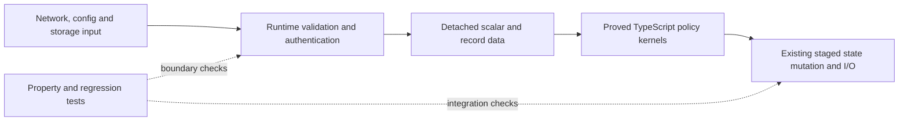

# LemmaScript feasibility and verification boundaries

LemmaScript is economical for small, stable, security-relevant policy kernels
in Peerborne. A whole-product or "most of Peerborne is verified" claim is not
currently justified. The application depends on asynchronous browser behavior,
cryptography, CRDT engines, storage and libp2p, and much of its own orchestration
combines those effects with mutable state. Counting verified source lines would
hide those trust boundaries.

The practical refactor is to separate runtime validation and I/O from pure
decisions over detached data. This change implements that separation for
quorum selection, authority deduplication/equivocation, BeeKEM generation
admission, leaf-count transitions and traversal resource accounting. The
existing runtime calls the proved functions. It does not replace them with
an independently maintained proof model.

## What is proved

| Production policy                                                     | Universal property under its input contract                                                                                                                              | Runtime use                                                   |
| --------------------------------------------------------------------- | ------------------------------------------------------------------------------------------------------------------------------------------------------------------------ | ------------------------------------------------------------- |
| [Work budget](../packages/core/src/policy/work-budget.ts)             | A reservation succeeds exactly when it fits; accepted addition stays within the budget and the safe-integer domain.                                                      | Change-tree edge admission before pending children are added. |
| [BeeKEM transition](../packages/core/src/policy/beekem-transition.ts) | Exact classification of stale, duplicate, conflicting, next and skipped generations; a leaf count can stay unchanged or append one within capacity.                      | The real staged BeeKEM PathUpdate handler.                    |
| [Quorum policy](../packages/core/src/policy/quorum.ts)                | Strict-majority default; preservation of an explicit trust floor; success only for the unique qualifying digest bucket, with complete rejection of ambiguity or absence. | Initial-load decision and orchestration.                      |
| [Authority votes](../packages/core/src/policy/authority-votes.ts)     | Exactly the first vote from each authority is eligible; equivocation is detected iff that authority supplied different digests.                                          | Authenticated probe results before transport-peer tallying.   |

These are eight functions in four closed proof units. The proofs do not
establish that an arbitrary peer is an authenticated authority, that signatures
are unforgeable, or that networked replicas eventually resolve an epoch fork.
The [feature audit](feature-audit.md) and existing security limitations still
apply. In particular, a proof of safe fork rejection is not a proof of automatic
fork reconciliation or post-compromise security.

## Cost and tractability

The completed pilot checks in roughly eight seconds on the development host;
the measured duration is recorded with source/proof hashes and tool versions
in the generated report. First-time setup downloads the compiler dependencies
and a roughly 55–65 MB Dafny distribution. Proof authoring, specification review
and validating the JavaScript/model boundary dominate cost; repeated CI checks
are comparatively cheap. Timing is an observation, not a cross-machine budget.

The current inventory finds roughly 58,000 physical first-party TypeScript
lines, about 2,500 function bodies including callbacks, and about 1,000 await
expressions. Re-run `yarn verify:formal:inventory` for the exact current values.
Those structural counts do not measure correctness or purity. They do show why
annotating the whole repository is a different project from proving a policy
kernel.

| Surface                                                   | Practical approach                                                                                       | Remaining work                                                                                      |
| --------------------------------------------------------- | -------------------------------------------------------------------------------------------------------- | --------------------------------------------------------------------------------------------------- |
| Pure policy, arithmetic and bounded collection algorithms | High-value LemmaScript candidates; keep implementations and contracts together.                          | Add loop invariants and explicit domains incrementally.                                             |
| Membership and ACL admission                              | Extract deterministic state/effect planning from asynchronous execution.                                 | State invariants and authorization provenance need review before expanding the proof boundary.      |
| Parsers, wire guards, proxies and typed-array ownership   | Keep the defensive runtime boundary and test malformed inputs; prove a canonical-data core where useful. | A proof over a decoded record does not prove the decoder accepted only safe records.                |
| Async commit, cancellation, retries and crash recovery    | Make captured inputs, staged state, commit points and failure states explicit.                           | Sequential function proofs alone do not cover arbitrary schedules, durability or eventual progress. |
| Cryptographic protocol secrecy and compromise             | Use explicit cryptographic assumptions and protocol analysis.                                            | LemmaScript is not a proof of Web Crypto, entropy, key erasure or protocol secrecy.                 |
| CRDT engines, WebRTC, libp2p and IndexedDB                | Retain algebraic properties, integration tests and browser stress measurements.                          | Dependency and platform behavior remain outside this proof.                                         |

A wholesale rewrite would increase risk without removing those last trust
boundaries. Continue extracting cohesive policy modules when a concrete
invariant needs proof. Avoid rewriting clear production algorithms solely to
fit an immature emitter, weakening contracts, or replacing every unsupported
operation with an assumed contract.

## Important toolchain findings

The tool is a tech preview with a supported subset, not a verifier for arbitrary
JavaScript. Its [numeric model](https://github.com/midspiral/LemmaScript/blob/f245e9878aa23a3c4a2d3f75ade4a44cebd545dc/SPEC.md)
does not model IEEE-754 rounding, NaN, Infinity or JavaScript int32 wraparound.
The bounded arithmetic here stays exact at runtime; runtime model-calibration
tests remain useful. UTF-16 strings are selected explicitly, including lone
surrogates. The Unicode-scalar default would be the wrong model for general
JavaScript string keys.

An imported helper can be emitted as a body-less assumed contract. The initial
experiment exposed that boundary directly. The production kernels are therefore
closed proof units, and every completed proof must pass Dafny's assumption audit
with zero findings. Proof additions may not replace generated implementation
lines. Domain witnesses and deliberate semantic mutations guard against vacuous
or disconnected green checks.

Protocol-level adversarial interleavings need a complementary model. For
example, [Tamarin](https://tamarin-prover.com/manual/master/book/001_introduction.html)
models security-protocol traces and adversary knowledge. Such a model would be
additional evidence with its own assumptions and implementation correspondence,
not proof coverage supplied by the current LemmaScript kernels.

## When proofs replace tests

A completed proof can replace example tests of the exact property, on the
exact verified implementation, inside its stated model and preconditions.
It does not discharge the runtime adapter, JavaScript semantics, dependency,
compiler or integration assumptions automatically. Specifications also require
review: proving the wrong requirement does not protect the product.

Use formal CI for the universal kernel laws, property tests for unproved
algebraic behavior and model/implementation calibration, targeted regressions
for particular attacks, and integration/stress tests for asynchronous and
platform behavior. Keep existing parser, signature, rollback, serialization
and browser tests unless their actual behavior has been proved. See the
[formal workflow](../verification/formal/README.md) for reproduction and scope.

The property-test changes following this proof pilot are deliberately outside
the universal policy laws:

- [Tree arithmetic](../packages/core/src/beekem/tree-math.test.ts) generates
  supported indices and leaf counts through the maximum arithmetic domain.
  BigInt and binary-string oracles check roots, parity and levels; inverse,
  child, parent, path and copath relationships check bounded traversal.
- [Load-boundary helpers](../packages/core/src/load-quorum.test.ts) generate
  duplicate transport identities and arbitrary UTF-16 strings. They check
  stable representatives, input ownership, idempotence and equality semantics.
  They make no timing-side-channel claim.
- [Automerge](../packages/automerge/src/provider-properties.test.ts) and
  [Yjs](../packages/yjs/src/provider-properties.test.ts) generate concurrent
  set/delete histories and delivery priorities. Opposite delivery orders,
  duplicates, missing ancestry, serialized deltas, late replicas and snapshot
  recovery must converge; independent local map oracles and per-actor witnesses
  prevent a vacuous "everyone dropped the changes" success.
- The old majority-formula example table is replaced by one BigInt calibration
  property across JavaScript safe integers. The mathematical majority law is
  proved; this remaining test checks the runtime number-model assumption.

All new generated checks use fixed seeds, bounded workloads and shrinking.
Jest discovers them through the existing `yarn test` CI job. Keep the seed,
counterexample and shrink path reported by fast-check when reproducing a
failure. Fixed malformed-input, maximum-domain and security regression cases
remain where they exercise an unproved boundary or pin a known failure.
