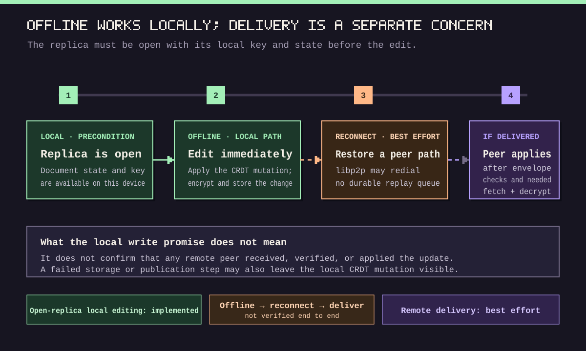

## Design intent

A local-first application stores its primary data on the user's device — not on a remote server. Changes apply to the local replica immediately, with zero network latency. The network is used to sync state between peers, not to enforce a global write order.

Peerborne adopts these local-first principles:

- **Local replica near the user.** The application reads and writes a local CRDT document. There is no server round-trip for reads or writes.
- **Work offline.** Once a replica is open—including a new local document—it can be edited without network access. Each change is applied to the CRDT at once, and its encrypted block is stored in the local blockstore (IndexedDB in a browser). Those blocks alone do not reopen a document after it closes: the application must save an [encrypted checkpoint](../storage/#local-checkpoints) and restore it before `open()`.
- **No server-ordained write ordering.** Two peers can edit the same document concurrently. The CRDT layer merges their changes when they eventually exchange updates.
- **Eventually consistent.** When peers reconnect, they may discover and fetch blocks that were created during the offline period. Delivery is not guaranteed — see limitations below.



**Evidence boundary:** open-replica editing and local storage are implemented.
The complete offline edit → reconnect → remote delivery sequence is not verified
end to end. Libp2p may redial keep-alive peers, but Peerborne supplies no
durable outbox, delivery receipt, or guarantee that a connection is restored
and missed announcements are replayed.

## What is implemented today

### Offline editing (open local replicas)

An open Peerborne document with its local state and key material available can
be edited offline. This includes a new document created locally without a peer
connection. The `document.change()` call applies the mutation to the local
Yjs, Automerge or Loro replica immediately, and its promise resolves once the
change is committed locally. Encrypting and publishing the change's sync frame
come after that commit, and their failure does not reject the call.

```ts
await todos.change((state) => {
  state.getArray<string>('items').push(['buy milk']);
});
```

The encrypted change payload is stored before publication is attempted, so it
stays in the local blockstore even if publication fails. Libp2p may restore
some peer connections, but missed-update replay and delivery are not
guaranteed.

### What `change()` covers

The `document.change()` promise resolves when the change is committed locally:

1. The CRDT provider has applied the mutation to the local replica
2. The change payload has been serialized and encrypted with the document key (AES-GCM by default)
3. The ciphertext has been stored in the local Helia blockstore, producing its CID
4. A separate `CRDTSyncMessage` has been built with that CID and inline history, signed when signing is enabled, and checked against the frame size limit
5. That message has become the document's retained change tree

Encrypting the message and publishing it through GossipSub follow. If either
fails, or the frame reaches no peer known to serve a member, the call still
resolves and the change stays committed. The failure is reported to
`document.subscribeDeliveryFailures()` handlers and through
`document.deliveryFailure`, which `subscribeDeliveryState()` handlers observe
as it is set and cleared. A coordinated document
(`peerborne.doc(path, { security })`) rejects instead.

A failure before the commit, such as a storage quota error or a failed
signature, rejects the call and discards the change. Automerge returns to a
writable copy of the document from before it. Yjs and Loro cannot undo an
in-place edit, so the instance is retired and must be reopened from accepted
state. See
[Local changes that fail before publication](#local-changes-that-fail-before-publication)
for the other cases.

## What is not yet implemented

### No durable outbox

If a peer is unreachable when `change()` publishes to GossipSub, the update may not reach them. Peerborne does not persist a queue of outgoing changes to retry later. There is no delivery acknowledgment or guaranteed-at-least-once semantics.

### No delivery acknowledgment

When a change is published, there is no confirmation that remote peers received, verified, or applied it. The application must implement its own acknowledgment protocol if it needs delivery guarantees.

### No durable reconnect-and-replay guarantee

Libp2p can redial peers tagged for keep-alive, including relay reservation
paths. Peerborne does not provide a durable reconnection/outbox protocol that
guarantees connection restoration or replays announcements missed while a peer
was offline. Applications that require recovery must observe connectivity and
coordinate their own retry, resynchronization, or acknowledgment flow. See the
[networking page](../networking/) for transport details.

### Close and restart need an application checkpoint

Documents store encrypted blocks in browser IndexedDB via Helia's blockstore,
but the blocks do not hold the document keys, membership or CRDT state needed
to reopen it. After `close()`, a new `peerborne.doc(path).open()` loads from a
connected peer; with no peer that holds the document, it rejects with
`No document state is available`. To reopen offline, export an
[encrypted checkpoint](../storage/#local-checkpoints) after each change and
restore it on the fresh instance before `open()`. Peerborne Note and the
password-manager example do this, and their CI suites reopen documents after a
full Chromium relaunch; the wiki example's suite reopens an article after a
reload. Other applications must test their own checkpoint path.

### Local changes that fail before publication

A `change()` call or `endChange()` batch is committed locally once its block is stored and it is in the retained change tree. From then on the call resolves even if encrypting or publishing its frame fails, for example because a GossipSub node configured without `allowPublishToZeroTopicPeers` has no topic peers. With the default configuration, which allows publishing to zero topic peers, a frame that reaches no peer known to serve a member is a delivery failure too, reported with a `NoDeliveryPeersError`. A peer proves it serves a member only by publishing a sync request signed by a member's key that names that peer as its publisher. A writer-signed frame proves nothing about the peer that published it, because any peer can republish one, so a relay subscribed to the document topic never counts. The change stays in the document, local update handlers run, the next change's frame carries it inline, and sync and load responses serve it. The failure is reported to handlers registered with `document.subscribeDeliveryFailures(id, handler)`, which receive the document path, the change's CID and the error; use them, or `document.deliveryFailure`, to show that an edit has not reached a member yet, not to repeat it. `deliveryFailure` holds the latest such change until there is evidence that a member holds the change or was sent it: a later frame sent to a peer that recently proved it serves a member, a member's sync request that names the change, or a writer's frame that builds on it. A load served to a member is not evidence until that member's next sync request names the change. This is evidence of delivery, not an acknowledgment that a member stored the change. A frame that reaches members only through another peer, such as a relay mesh, is reported until a member's next sync request names it; with automatic catch-up enabled that is usually a few seconds. A failure from a local update handler or compaction rejects the call but also keeps the change.

A change that fails before that point, because the blockstore exceeds its storage quota or signing fails, is discarded, so no later change depends on an edit that peers never received. An Automerge document returns to a writable copy of its state before the change, which makes later changes under a new actor. Yjs and Loro edit in place and cannot undo the edit, so the instance is retired instead, as is an Automerge document that holds remote changes waiting for missing dependencies. The call rejects with an error whose `cause` is the failure. A retired instance refuses further changes and checkpoints, and `document.retired` is `true`, until it is reopened from accepted state, such as the last checkpoint exported before the failure. A `@peerborne/store` store then reports the `retired` status, and a TanStack DB collection over it fails rather than show the discarded edit.

Storage and signing failures are not always permanent. A transient IndexedDB write error, or a remote or WebAuthn signer whose prompt the user cancels, also retires a Yjs or Loro instance. Reopening from the last checkpoint then loses every change made after that checkpoint that peers have not received, including changes reported to `subscribeDeliveryFailures()` handlers, because those exist only on this device. Export a checkpoint after each committed change, and always after a delivery failure, so that reopening keeps them. A checkpoint holds the document's state and its document keys: save it only as `exportEncryptedCheckpoint(storageKey)` produces it, or encrypted by the application, and never send it to another party. See [Local checkpoints](../storage/#local-checkpoints).

## The infrastructure boundary

"Local-first" does not mean "infrastructure-free." Browser nodes do not bind
ordinary inbound TCP sockets. Peerborne's browser default nevertheless
advertises circuit-relay, WebRTC, and WebSocket listen addresses and enables
WebRTC, WebRTC Direct, WebTransport, and relay transports. Bootstrap discovery
is optional: without a configured bootstrap peer or an explicit `connect()`
address, the default node remains a swarm of one. The current cross-NAT
Peerborne acceptance test explicitly dials a Circuit Relay address; direct
WebRTC/WebTransport document sync and DHT behavior remain unverified.

Depending on the deployment topology, supporting infrastructure can include:

- **Relay nodes** to bridge NAT for browser peers
- **Bootstrap nodes** as well-known entry points for the libp2p network
- **STUN/TURN servers** for WebRTC hole-punching (optional, for direct peer connections)

A relay that does not hold the document key forwards ciphertext; bootstrap and
STUN provide discovery or address metadata rather than document plaintext.
Infrastructure components can still observe network metadata, and any
component that is also enrolled as an authorized document peer can decrypt
according to its keys.

See [running a relay](../../cookbook/running-a-relay/) for the development relay setup.

## What local-first Peerborne is a good fit for

Peerborne's local-first model works well for:

- **Small collaborative documents** (todos, notes, wikis, password vaults) where the document fits in a single CRDT replica
- **Applications that own identity and recovery** — Peerborne does not provide authentication or key recovery
- **Deployments where you control the relay infrastructure** — there is no cloud service to delegate to
- **Experiments and prototypes** learning about local-first architecture

It is not a good fit for:

- Large datasets (hundreds of megabytes per document)
- Applications that need SQL or relational queries
- Production systems requiring guaranteed delivery and durability
- Applications expecting a managed backend service

## CI-backed evidence

These behaviors are verified by CI:

- Document creation, local mutation, and retrieval in a single browser session
- Encrypted existing-history retrieval through Circuit Relay
- Automerge and Yjs provider initialization and basic operation
- Crypto operations (signing, encryption, key generation)
- Peerborne Note and the password-manager example reopening documents from their encrypted checkpoints after reload and a full Chromium relaunch, and the wiki example after a reload

These behaviors are **not** verified:

- Restart recovery in other applications, or from IndexedDB blocks without a checkpoint
- Offline editing with later reconnection and delivery, outside Note's bounded relay-outage gate
- Guaranteed transport reconnection and missed-update replay

## Next steps

- [Architecture](../architecture/) — data flow and system structure
- [CRDT model](../crdts/) — how Yjs and Automerge integrate
- [Limitations](../limitations/) — complete list of current gaps
