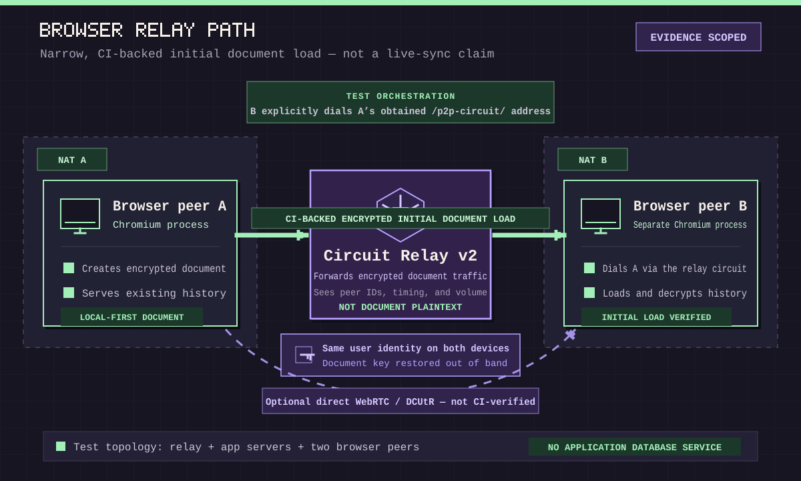

## Overview

Peerborne uses **libp2p** for all peer-to-peer networking. libp2p is a modular networking stack that handles transport, stream multiplexing, connection encryption, peer discovery, NAT traversal, and pubsub messaging — all in one framework.

## Transport protocols

Peerborne supports these transport protocols. The actual set used depends on the runtime (browser vs. Node.js) and network topology:

| Transport | Runtime | Purpose |
|---|---|---|
| **WebSocket** | Browser, Node.js | Reliable bidirectional stream. Used for relay and bootstrap connections. |
| **WebRTC** | Browser | Browser-to-browser direct connections (STUN improves NAT traversal; TURN or Circuit Relay may be needed for restrictive NATs). |
| **WebRTC Direct** | Node.js | Node-to-Node direct connections. |
| **WebTransport** | Browser (Chrome 97+) | Modern, low-latency QUIC-based transport. |
| **TCP** | Node.js | Traditional stream transport for Node.js peers. |

### Transport selection

```ts
import { defaultConfig, defaultBootstrapConfig } from '@peerborne/core';

const bootstrapPeers = [
  '/dns4/relay.example.com/tcp/443/wss/p2p/12D3KooW...',
];
const config = defaultConfig(defaultBootstrapConfig(bootstrapPeers));

// Pass config to Peerborne.initialize()
await swarm.initialize(config);
```

In practice, browser peers typically use WebSocket to reach a relay, and may upgrade to WebRTC or WebTransport for direct peer connections when NAT traversal succeeds.

`defaultConfig` is browser only: it stores blocks and data in IndexedDB, so
`initialize()` rejects with `indexedDB is not defined` under Node.js. Node
processes use `defaultNodeConfig` from `@peerborne/core/node`. Neither default
includes the TCP transport. The Node default's listen addresses bind no local
socket, so a Node process accepts connections only through a Circuit Relay
reservation. To let another node dial it directly, add a listen address that a
configured transport can bind:

```ts
import { defaultBootstrapConfig } from '@peerborne/core';
import { defaultNodeConfig } from '@peerborne/core/node';

const config = defaultNodeConfig(defaultBootstrapConfig([]));
const libp2p = config.helia!.libp2p!;
libp2p.addresses = {
  ...libp2p.addresses,
  listen: [...(libp2p.addresses?.listen ?? []), '/ip4/127.0.0.1/tcp/4010/ws'],
};
```

## PubSub: GossipSub

Document updates are announced and delivered via **GossipSub** — a pubsub protocol built on libp2p. Each document has a corresponding pubsub topic derived from its document ID:

```ts
// Document /todo-list → topic: /peerborne/document/v3/todo-list
// Changes published to this topic reach all subscribed peers.
```

Relays admit the current document namespace by default. A custom
`pubsubDocumentPrefix` requires a matching slash-terminated namespace in every
relay's `TOPIC_ALLOWLIST`. With an empty prefix, allow each concrete document
topic or explicitly select unrestricted `*` mode. All peers must use the same
runtime and topic prefix.

Topic names are public routing labels, not authentication, authorization, or
wire validation. Application URLs such as `/document/:id`
are unrelated and do not change.

GossipSub is **best-effort**:

- Messages are relayed through the mesh, not stored
- Peers that join late may miss announcements
- There is no message persistence, acknowledgment, or guaranteed delivery
- Initial load and catch-up use point-to-point bitswap / HTTP fetch, not GossipSub

### Receive capacity

Each open document processes at most 16 frames and 16 MiB of ciphertext at a
time, and all documents together at most 64 frames and 64 MiB. A frame that
arrives while the document's budget is full is skipped, but the latest skipped
frame of each GossipSub sender is retained, holding one of the shared credits.
One at a time, a retained frame is checked to decrypt under the document's
current key; a frame that passes is kept and processed once a credit frees. A
writer's later frames carry its earlier changes inline, so this recovers the
end of a typing burst. A sender's frame is only replaced by a newer one from
the same sender, and a frame that fails the check, including one under a
retired epoch key, is never kept. At most eight senders and 16 MiB are kept
per document; sync requests are dropped first, then the oldest frame. A frame
skipped while the shared credits are exhausted is not retained.

### Frame size

`@libp2p/gossipsub` sends and accepts RPCs of at most 4 MiB, and the outbound
limit is not configurable. A longer RPC is never sent: `publish()` resolves
with no recipients and no error. Peerborne caps one serialized sync message at
3.5 MiB (`MAX_GOSSIP_SYNC_MESSAGE_BYTES`), leaving room for encryption, the
GossipSub envelope and piggybacked control messages.

Every frame carries the retained change tree inline, so the cap is split in
half:

- **One change** may need at most 1.75 MiB on its own
  (`MAX_CHANGE_FRAME_BYTES`). A larger one is refused before a block is
  stored: `change()` or `endChange()` rejects with `GossipFrameLimitError`
  and nothing reaches history. The edit is already in the local document,
  because Yjs edits in place and Automerge marks the previous document
  outdated, so the instance is retired as for an oversized block; reopen it
  from accepted state and split the edit.
- **The retained tree** is compacted once the change frame that carried it
  passes 1.75 MiB: the writer snapshots and keeps only its newest changes, up
  to 512 KiB of payload, and a depth-bound compaction keeps no more than that
  either. A writer that adopts a published change frame prunes the same tree
  the same way. A `requestSync()` reply does not trigger this, since it can
  carry a snapshot the author never published. Retained trees then match, but
  load digests can still differ, because each writer signs its own snapshot.
  A reader keeps the larger tree, as with depth-bound compaction. A peer that
  missed the pruned changes recovers them with `requestSync()` or a load.
- **A membership change** is never refused for retained size: if its frame
  would not fit, the tree is compacted first and the change published again.

A `requestSync()` reply that does not fit GossipSub, usually because of its
snapshot, is not sent and does not use up the request or the response rate
limit. The responder logs a warning, and the requester must load the document.

## Peer discovery

Peerborne peers find each other through several mechanisms:

### Bootstrap nodes

A static list of well-known peers that new nodes connect to first:

```ts
bootstrap: [
  '/dns4/bootstrap.peerborne.dev/tcp/443/wss/p2p/12D3KooW...',
  '/ip4/192.168.1.100/tcp/4002/p2p/12D3KooW...',
]
```

Bootstrap nodes introduce the new peer to the network. They do not store or relay document data.

### Kademlia DHT

Once connected, nodes participate in a distributed hash table (Kademlia) for peer and content routing. The DHT maps peer IDs to multiaddrs and CIDs to providers.

### AutoNAT

AutoNAT determines whether a peer is reachable from the public internet. If a peer is behind NAT, it cannot accept incoming connections and must use a relay.

## NAT traversal

Browsers and most home/office networks are behind NAT, which prevents direct incoming connections. Peerborne uses several mechanisms to work around this:

### Circuit Relay v2

A relay node bridges traffic between two peers behind NAT:



**Evidence boundary:** The solid relay path represents the narrow CI-backed result: one user identity runs in two NAT-isolated Chromium processes, the document key is restored to the second device out of band, and that device loads existing encrypted document history through Circuit Relay. The test reads peer A's `/p2p-circuit/` address and has peer B dial it explicitly; it does not establish a separate bootstrap-discovery proof edge. The topology has app servers and a relay but no application database service. It does not demonstrate live post-load synchronization, invitation delivery, direct WebRTC/DCUtR, relay failover, or production deployment behavior.

The relay forwards encrypted packets. It sees metadata (peer IDs, timing, data volume) but cannot decrypt document content.

Relayed connections are limited connections in libp2p. Peerborne runs Bitswap on them by default (`helia.bitswap.runOnLimitedConnections: true`), so a peer reachable only through a relay can still fetch change blocks within the relay's circuit data and duration limits. Setting it to `false` stops block fetches over relays, which can stall loads and invitations.

Streams that accept limited connections, Bitswap included, open on the existing relayed connection to the peer. On its own, libp2p reuses only unlimited connections and dials a new circuit for each such stream. libp2p limits inbound connections per host, five per second by default, and counts every relayed connection against the relay's host, so a burst of block requests would be refused and the load would stall. The stream opens on the relayed connection at once. When the peer also has a direct or WebRTC address that this node has a transport for, one libp2p dial per relayed connection runs in the background to upgrade it, and later streams use the unlimited connection if that dial succeeds. Streams that need an unlimited connection always get the libp2p dial, and DCUtR upgrades are unaffected.

Different peers that arrive through one relay share that per-host budget. `defaultConfig` and `defaultNodeConfig` therefore set `connectionManager.inboundConnectionThreshold` to `DEFAULT_INBOUND_CONNECTION_THRESHOLD` (128 per second). libp2p still bounds open connections with `maxConnections`, and refuses a new inbound connection while 10 upgrades are pending (`maxIncomingPendingConnections`), so more than ten peers arriving at the same moment still see refusals. A custom libp2p config should set the same option; with the libp2p default, the sixth peer to join or reconnect through a relay within a second is refused.

### DCUtR (Direct Connection Upgrade through Relay)

After an initial relayed connection, peers attempt to establish a direct WebRTC connection using DCUtR. The relay facilitates the hole-punching handshake; if successful, peers communicate directly, reducing relay load and latency.

### STUN / TURN

- **STUN** servers help peers discover their public IP and port for WebRTC hole-punching.
- **TURN** servers relay media when direct WebRTC connections are impossible (e.g., symmetric NAT). TURN is more expensive than Circuit Relay but handles a broader range of NAT types.

## Relay trust model

Relays are the most important infrastructure component in a Peerborne deployment, and their trust properties matter:

**What relays can see:**
- Peer IDs and multiaddrs of connecting peers
- Connection timing and duration
- Data volume and message frequency
- PubSub topic IDs (derived from document IDs)

**What relays cannot see:**
- Document content (encrypted with the document key; AES-GCM by default)
- Signing keys or document keys
- ACL entries or identity information (embedded in encrypted blocks)

**What relays can do:**
- Drop, delay, or reorder messages
- Terminate transport connections and forward relayed traffic
- Censor specific peers or topics
- Log metadata about who communicates with whom

**What relays cannot do:**
- Decrypt document content without the document key
- Forge application-level signatures without the signing private key
- Authenticate as another peer at the libp2p level (Noise provides end-to-end peer authentication)
- Modify encrypted blocks (detected via CID integrity check)

### Identity pinning risk

A relay that loses its identity file restarts with a new peer ID and breaks clients pinned to the old identity. The standard relay image persists an app-managed key on its `/shared` volume; hosted deployments must likewise mount durable storage at `RELAY_IDENTITY_KEY_PATH`. DNS (`/dns4/...`) changes address resolution but `/p2p/<peerID>` still pins the relay identity. Never share one private identity between concurrently running relays.

## Diagnose connection failures

Use the SDK's structured progress callback to distinguish dialing, transport
opening, secure-channel setup, retries, and final failure:

```ts
await peerborne.connect([relayMultiaddr], {
  signal: AbortSignal.timeout(30_000),
  maxAttempts: 3,
  retryDelayMs: 1000,
  onProgress: (event) => console.info('Peerborne connection', event),
});
```

Events contain only stage, address index/count, attempt limits, elapsed time,
cancellation state, and a fixed error-type label. Native progress details,
addresses, raw errors, invitation URLs, and document data are not included.
The rejected error remains available to the caller for controlled debugging;
use the progress event when recording diagnostics. Observer exceptions and
rejections are isolated from the operation.

The default is one attempt. At most three attempts are allowed, and only
transport failures, closed connections, or timeouts qualify for retry.
Authentication failures and caller cancellation stop the attempt sequence.
An established transport does not establish a relay reservation or verify an
invitation. Applications should report those later phases separately.
The optional `NetworkStats` container still requires explicit `record*()` calls.

## Resume a saved document

An application restoring an authenticated checkpoint should reconnect its
transport, open the restored document and call `document.requestSync()`.
The request is signed by a current reader or writer and encrypted with the
document key. Writers respond with normal signed updates, so the existing
membership and change validation remains in force. Fresh nonces, timestamp
bounds, recent-request deduplication and response throttling bound replay and
amplification. Known roots avoid repeatedly sending an already received update.
Peerborne Note runs this recovery automatically after opening a saved shared
note. Catch-up requires an online member with the current key; it does not
restore a lost identity or recover an unknown group-key epoch.

## Operational limits

- **Relay identity requires durable storage.** Restart preserves the peer ID only while the configured identity file survives. Losing it requires clients to learn a new peer ID.
- **No relay meshing.** Each relay operates independently. There is no relay-to-relay routing.
- **Topic allowlists are not Circuit Relay policy.** `TOPIC_ALLOWLIST` controls only which GossipSub topics the relay node auto-subscribes to. It does not inspect or restrict opaque, Noise-encrypted Circuit Relay streams, authenticate publishers, or authorize documents.
- **Readiness is local evidence.** `/readyz` confirms local startup and seed subscriptions, not a remote reservation or end-to-end convergence.
- **No durable storage on relay.** The relay does not store messages. If a subscriber is offline, it misses messages.

## CI-backed evidence

Verified in CI:

- WebSocket transport through Circuit Relay in Docker-backed NAT tests
- Cross-NAT encrypted document retrieval (real Peerborne nodes behind NAT)
- Basic peer discovery (bootstrap connection) in integration tests
- GossipSub message delivery in NAT topology

Not verified:

- WebRTC direct connection upgrade (DCUtR)
- WebTransport transport
- Relay failover (kill one relay, verify peers reconnect through another)
- Live post-load convergence under network partition
- AutoNAT detection and relay fallback
- DHT content/provider routing at scale

## Next steps

- [Running a relay](../../cookbook/running-a-relay/) — set up a development relay
- [Security model](../security/) — how the trust model interacts with encryption and ACL
- [Limitations](../limitations/) — complete list of networking gaps
