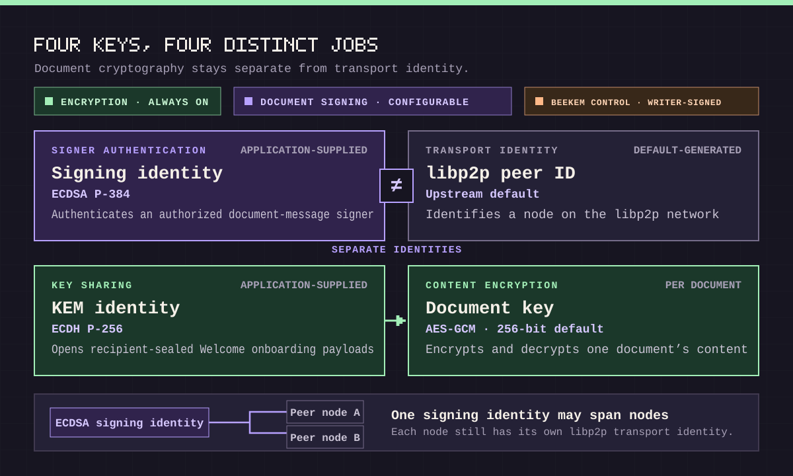
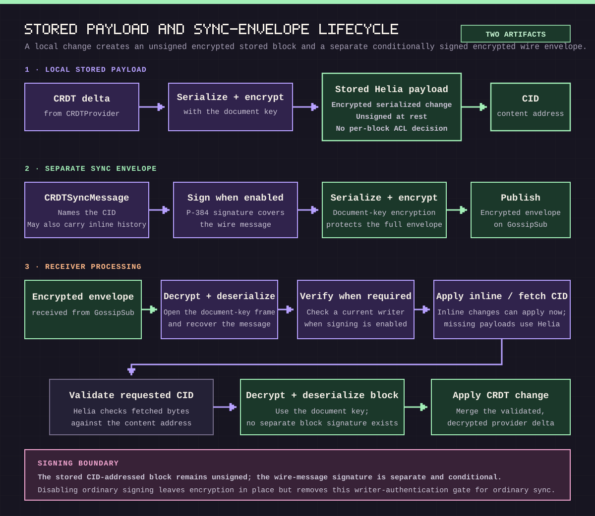

## Overview

Peerborne encrypts stored change payloads, ordinary GossipSub sync envelopes,
and load responses. With document signing enabled (the default), those outgoing
`CRDTSyncMessage` payloads are signed before their serialized envelopes are
encrypted; load requests also carry a signature. A document change payload
additionally carries its author's signature inside the encrypted block, which
[binds its CRDT actor](#crdt-actors-are-bound-to-change-signers) to that
author, and so does a reader or writer ACL change. Keychain payloads have no
writer signature of their own.
Relay and other infrastructure not given the document key handle ciphertext
rather than document plaintext; they never need a signing private key. During
normal post-load sync, once a trusted writer set exists, a peer without a
current writer key cannot produce an ordinary sync message that receivers
accept. A first load has no prior writer set for authenticating its selected
outer response and instead uses the narrower configured quorum/CID gates.

## Experimental coordinator-backed mode

`swarm.doc(path, { security })` enables a separate signed content format,
controller/role history and optional device-key encrypted replay journal. The
actual Automerge/Yjs document path uses staged admission; legacy load and ACL
handlers cannot bypass it. A pinned authority root, a group-security provider,
and an independent persistent rollback anchor remain application responsibilities.
Before each group-state commit, the coordinator records a write-ahead intent in
that anchor naming the exact next store snapshot. Coordinators that share one
store, such as several tabs, add their intents beside each other. The anchor
keeps up to eight per anchored state and drops the oldest first. If a commit's
outcome is unknown, or the anchor update after it fails, the live coordinator
stops. Restore then completes the commit when the store holds exactly one of
the recorded snapshots. It accepts a store that still holds the anchored
snapshot and keeps the intents until the next commit clears them. Any other
store fails closed. One interrupted commit therefore requires a restore rather
than leaving the group unopenable on that device. More than eight commits
racing from the same anchored state can still drop the intent of one that
lands. Focused tests show this with in-memory stores and anchors only.
A member that joins without content, or whose frames stay held after a
redelivery request, asks the controller for a checkpoint on the document topic
by itself. A checkpoint carries the whole document state, including history
from before the member joined; the controller's `authorizeCatchUp` option
decides which members receive one. Further anti-entropy, field permissions and device performance
qualification are not supplied by this mode. The default BeeKEM
workflow described below remains separate. See the repository
[coordinated document evidence and limits](https://github.com/peerborne/peerborne/blob/main/docs/coordinated-document-security.md).

## Identity and trust roots

| Key | Algorithm | Purpose | Managed by |
|---|---|---|---|
| **Signing key** | ECDSA P-384 | Authenticates an authorized document-message signer | Application |
| **KEM key** | ECDH P-256 | Opens recipient-sealed Welcome onboarding payloads | Application |
| **Document key** | AES-GCM (256-bit; bundled document-key path) | Encrypts/decrypts document content | Peerborne (per-document) |
| **libp2p peer ID** | Upstream default | Identifies the node on the libp2p network | Generated by default; configurable |



**Evidence boundary.** This diagram maps implemented key roles and documented configuration behavior; it does not imply that Peerborne provides application-key onboarding, recovery, or complete revocation workflows.

The signing key and KEM key are **application-supplied**. Peerborne does not generate, store, recover, or back up user keys — key management is entirely the application's responsibility.

The libp2p peer ID is separate from the signing identity. This means:
- Changing the libp2p key (e.g., relay restart) does not change the document signing identity
- The same signing identity can be used across multiple libp2p nodes
- Applications can supply libp2p private-key configuration instead of using the generated upstream default

## Signed invitations

The initial online invitation protocol binds three signed envelopes:

1. The founder signs an expiring offer containing the document ID, requested
   role, issuer identity, and founder rendezvous addresses.
2. The recipient signs a join request bound to the exact offer, their signing
   identity, and their raw P-256 KEM public key.
3. The founder signs an acceptance bound to both earlier envelopes. Its BeeKEM
   Welcome is sealed to the recipient KEM key, and its initial document state
   is encrypted under the document key.

Accepting an invitation verifies every binding and the resulting ACL before
opening the document. Failure never falls back to new-document creation. See
[Invite a collaborator](../../cookbook/invitations/) for the API and its
founder-plus-one, online-only trust boundary. Invitations require the attested
Automerge capacity profile, so Yjs and Loro documents are founder-only: they
cannot be shared with another identity.

Before changing membership, the founder also performs a fail-closed capacity
check. The bundled Automerge JSON providers and P-384/SHA-384 SubtleCrypto
declare the one profile whose bounds Peerborne tests. It combines the retained
sync tree, complete keychain, latest snapshot, tips, signature, projected ACL
growth, encryption framing, and a 128 KiB reserve under the 1 MiB wire-field
cap. A custom provider is rejected unless it deliberately implements the same
capacity-profile attestation; doing so makes that provider responsible for
preserving every declared bound. The exact sealed Welcome and encrypted
bootstrap are checked again after construction.

An offer is still a bearer capability. Its self-signature does not identify a
human or organization, and the first person who obtains the link can claim its
role. Applications should deliver it through an authenticated private channel
or separately verify the issuer fingerprint.

## Implemented authorization

### Reader/writer ACL

Each document has an access control list with two roles, reader and writer.
Grant a role to another identity with a
[signed invitation](../../cookbook/invitations/), which requires an Automerge
document; a Yjs or Loro document cannot be shared. The founder opts into
sharing the retained history, installs its KEM key pair and creates the offer;
the recipient accepts it with its own signing identity and KEM key pair:

```ts
document.historyVisibility = 'full_history';
await document.setKemKeyPair(kemKeyPair);
const offer = await document.createInvitation({
  role: 'reader',
  rendezvous: [founderCircuitAddress],
  // Store a checkpoint that records the new member before the key is released.
  beforeAcceptance: async () =>
    saveCheckpoint(await document.exportEncryptedCheckpoint(storageKey)),
});

// Promote an existing explicit reader to write access
await document.addWriter(peerSigningPublicKey);
```

- **Readers** receive recipient-sealed keychain material through the Welcome in a signed invitation acceptance and decrypt content for epochs whose keys they hold. `addReader()` cannot onboard a new identity: a recipient with only a KEM key pair cannot authenticate a broadcast Welcome or decrypt the reader ACL row that admits it, so it could never open the document. It rejects any identity that is not already a reader before changing the ACL, and only resends the Welcome to an existing reader.
- **Keys enter a replica only through its own rotations.** A replica gets document keys from creating the document, its issuer-pinned invitation, its own checkpoint, or BeeKEM rotations it derives itself: its own `removeReader()` or an authenticated PathUpdate. Any writer can sign a broadcast Welcome, so a replica applies one only while it holds no document key, ratchet tree or invitation epoch; it cannot add a key to a replica that has one or replace that replica's tree. Load and invitation catch-up responses may only re-deliver keys the receiver already holds, and a response that would change its key sequence is refused before any of it is applied.
- **Writers** sign ordinary sync messages that carry new changes. The local `addWriter()` API requires the target to have both an explicit reader row and a unique live BeeKEM leaf, so invite it as a `reader` before promotion, or invite it as an `editor`. The identity-to-KEM binding is kept by the founder document instance and its checkpoints. During post-load sync, receivers verify the outer signature against their current writer list before applying the message when signing is enabled.
- Local role changes share a document mutation queue. `removeReader()` rejects an identity that is still a writer; demote it with `removeWriter()` first. `removeWriter(key, { requireRemainingWriter: true })` rejects with `LastWriterRemovalError` when no other writer would remain; it checks inside that queue, but concurrent removals by other peers can still leave a document with no writers. Removing an identity with no reader row and no local KEM or leaf record also fails unless the live BeeKEM tree holds only the local leaf, because absent records cannot prove the identity was revoked. These checks do not make the two replicated ACLs globally atomic: independently received ACL changes can temporarily reflect different roles on different replicas. The roles converge, but the content need not: edits made concurrently with your own demotion remain only on your replica. Every replica that applied the demotion rejects them, the demoted replica keeps them permanently, and nothing signals the divergence. A retried ACL change can leave two additions of the same identity in the history, because a publication rejected after delivery is rolled back only locally. When a removal observes only one of them, the Automerge ACL applies the removal on every replica, and a later addition that observes the removal restores the identity.
- **ACL changes wait for the ACL history they depend on.** A receiver merges the ACL nodes of a delivered tree causal ancestors first. A change whose dependencies it still lacks, such as a Yjs struct whose client's earlier clocks never arrived or an Automerge change that cites an unknown hash, is never merged into the live ACL, so membership checks, role changes and checkpoints keep working. The receiver holds the change outside the ACL and does not record its node, so later deliveries carry it again, and merges it as soon as a later ACL change supplies its dependencies. Each signer, the change's author when the ACL binds actors and otherwise the frame's signer, holds at most 64 such changes and 4 MiB per document, and a document holds at most 256 and 16 MiB; past a bound, the signer holding the most gives up its oldest change. Held changes are not checkpointed.
- **Ordinary document sync signing is configurable.** Initial loads, security advertisements, and BeeKEM Welcome and PathUpdate membership-control messages remain writer-authenticated even when `enableSigning` is `false`.

Where the receiving operation verifies a sync-message signature, that
signature covers an exact `signatureContext` tag chosen by the operation. This
prevents a captured, valid body from being reused by a different same-shaped
authenticated handler after re-encryption. It does not prevent replay within
the same context, and an authorized writer can still intentionally sign a new
message for any operation its role permits.

The reader-row and live-leaf promotion checks above are local API guards. An
incoming raw ACL delta is not yet checked against replicated identity/KEM
transition records, so this is not an end-to-end membership invariant across
replicas.

### Current-writer authorization only

When document signing is enabled, ordinary inbound sync envelopes are
authorized against that replica's current writer ACL. Grants do not expire
automatically; they remain accepted until that replica applies a writer-removal
ACL update. With `enableSigning: false`, ordinary inbound sync skips this
writer-signature gate. The standalone `ACLChain` implementation is not wired
into this path. Authorization is consequently local and order-dependent: a
stale or partitioned writer can race a removal with a signed ACL re-grant while
another replica still considers that writer current. Beyond this gate, there is
no:

- Role-based access beyond reader/writer
- Delegation or sub-key authorization (UCAN capabilities exist but are not integrated)
- Rate limiting or abuse prevention

### CRDT actors are bound to change signers

Yjs client IDs, Automerge actors and Loro peer IDs are visible in every update,
and each CRDT identifies an operation by its actor and counter. If two writers
produced different operations at the same position, a replica holding one
could never accept the other: Automerge and Loro reject every later change
that depends on it, and Yjs keeps whichever arrived first. A malicious writer
that wrote under an honest writer's actor would therefore cut replicas off
from that writer permanently, even after a snapshot. Ordinary documents
prevent this by binding every actor to the signer that owns it:

- A document instance draws a random 16-byte nonce before its first write and
  writes under the actor derived from SHA-256 of the document path, its
  signer's canonical public key and that nonce: 53 bits for a Yjs client ID,
  64 bits for a Loro peer ID and 128 bits for an Automerge actor. The signer
  also signs the document path and nonce, registering the actor. A rollback
  copy, a restored checkpoint, or a document whose actor otherwise changed
  draws a new nonce, so a position that may already be published is never
  reused.
- Every document change carries an authored-change envelope: the signer, the
  nonce, the registration signature and a P-384 signature over the document
  path, nonce and change bytes. It travels inside the encrypted block, so the
  block's CID, inline relays and fetched blocks all carry it.
- Before a change from any path is applied (GossipSub, `requestSync()`
  replies, loads, invitation bootstraps and fetched blocks), the receiver
  verifies the envelope and decodes, without applying the change, every actor
  it adds operations for: Yjs struct client IDs, Automerge change-header
  actors, and the version range of a Loro update. A Loro blob that is not an
  ordinary update, such as a shallow snapshot, is refused. Each actor must be
  the one the envelope derives. The inline changes of one message are all
  checked, concurrently, before any is applied, so a rejected change never
  enters the live document. A message whose own head fails is rejected, as
  is a message carrying any change that fails for a reason other than actor
  binding, such as bytes the CRDT cannot decode. A relayed change that fails
  actor binding is skipped instead, so a forgery that reached an honest writer
  cannot block that writer's own later changes. The skipped change is held as
  waiting, so the relayer's changes that build on it wait with it, and later
  trees are walked down to it again; it is applied if a later delivery passes.
  Deletions of, and references to, other actors' operations are not
  restricted.
- A change therefore introduces or extends only its own signer's actors. A
  writer that re-wraps another writer's change under its own envelope, or
  claims the other writer's nonce without its signature, is rejected. Relaying
  another writer's change with its envelope intact is accepted.
- A local change may contain operations under one actor only: the instance's
  own, or one it reserved with `document.reserveActor()` for a separate
  editing copy, such as the Yjs editor bridge's mirror or a template seeded
  from another `Y.Doc` whose client ID is the reserved actor. Release a
  reservation with `document.releaseActor()`; an instance holds at most 64
  and refuses another until one is released. A change function that applies
  operations made under any other actor, for example `Y.applyUpdate` of an
  unrelated document, is refused before anything is published. Automerge
  returns to a writable copy of the document under a new actor. Yjs and Loro
  edit in place and cannot undo it, so the instance is retired: reopen it
  from accepted state, as after any other change that cannot be rolled back.
  A Yjs local change carries only the transactions its change function ran,
  not the pending structs of other writers that Yjs would otherwise fold into
  it.
- A replica also remembers the first registration it admitted for each actor
  and rejects a different one. Signed snapshots carry a canonical manifest of
  the registrations the snapshotter remembers for actors in its state, each
  with its signer's own registration signature. A loader requires every
  entry to derive a distinct actor that is present in the state, verifies its
  registration signature, and checks it against its own bindings before
  applying the snapshot, including on a first load. A snapshotter therefore
  cannot bind an actor to a signer that did not register it. Load and
  advertisement digests cover the snapshot state without its manifest, so
  honest writers that remember different bindings still agree. Local
  checkpoints carry the remembered bindings.
- A replica remembers at most 4,096 bindings per signer, forgetting that
  signer's least recently used one beyond it, and 16,384 per document. Beyond
  the document limit it forgets the least recently used binding of the signer
  holding the most bindings, taken from signers that are not current writers
  first, so a flood of registrations under throwaway keys forgets their own
  bindings before an honest writer's. It never refuses a registration for
  capacity, so new sessions, restores, rollbacks and editor mirrors of an
  honest writer always write. Registrations whose signatures it has verified
  are remembered separately, so a later snapshot does not verify them again.

The binding costs two more signatures per new actor and one per local change,
the matching verifications on receipt, and about 360 bytes per change before
wire encoding. Its limits:

- A writer that searches about 2^53 (Yjs) or 2^64 (Loro) nonces for its own
  key can derive another writer's actor. A replica that remembers the
  victim's binding rejects that registration, but a replica that has seen
  neither, or has forgotten the binding, can accept it and then reject the
  victim's operations under that actor. Automerge's 128-bit actors make this
  search infeasible.
- A snapshot's content is attested only by its signer, who can still place
  operations under another writer's actor inside a snapshot it signs. Quorum
  loading, not the manifest, defends a loader against one malicious
  snapshotter.
- The envelope proves authorship; the outer writer signature still decides
  whether a message is accepted. An author does not need to be a current
  writer, so a removed writer's earlier changes keep syncing. A writer can
  register many actors, or sign changes with fresh keys, each costing an
  accepted change; memory stays bounded because bindings are forgotten, at
  the cost of the nonce-search protection above for forgotten actors.
- With `enableSigning: false` the envelope is unsigned and protects nothing
  against a peer that can decrypt the traffic.
- Coordinator-backed documents and the keychain CRDT do not use this binding.
  Several devices of one signer are distinct actors that are not protected
  from each other.

The reader and writer ACLs are bound the same way. Each ACL of a document
instance writes under its own actor, derived from the document path, the
ACL, the signer and a per-instance nonce, and every published ACL node
carries an envelope whose signature also covers the ACL, so a change cannot
be replayed into the other ACL or the document. A receiver verifies the
envelope of every inline ACL node of a message before merging any, and of
every fetched one before merging it, including the writer blocks a quorum
load uses to verify a snapshot. A relayed node that fails is merged nowhere
and waits; a failing root rejects the message. Each ACL keeps its own
first-seen bindings, and checkpoints carry them. An ACL change whose
publication fails burns its actor's position, so the next change is staged
under a fresh actor. Without the binding, a writer that saw another writer's
ACL change could write a different change at the same position, and a
replica that received it first kept it forever: under Yjs the replicas
disagreed on the members, and under Automerge the replica refused the honest
change and every change after it.

### UCAN capabilities

UCAN (User Controlled Authorization Networks) helpers exist in `@peerborne/core` as a standalone module. They are **not integrated** into the document change path. The UCAN module can:

- Issue capability tokens delegating specific permissions
- Verify capability chains
- Encode delegation proofs

But the document change path does not check UCAN tokens. UCAN integration is a future capability.
The optional [`UCANACL`](https://github.com/Peerborne/peerborne/blob/main/packages/core/src/ucan-acl.ts)
wrapper in `@peerborne/core` keeps capability metadata in process-local memory.
That metadata, including its revoked-key set, is neither replicated nor
enforced as shared revocation state; only the wrapped ACL's ordinary membership
change can reach other replicas.

## Encryption and history visibility

Peerborne encrypts stored payloads and wire envelopes through the configured
auth provider. The bundled document providers generate or import 256-bit
AES-GCM document keys. The lower-level `SubtleCrypto` auth primitive also
supports AES-CTR and AES-CBC, but that primitive support is not a bundled
document-key path. Peers can decrypt content only when they hold the needed
epoch key.

`historyVisibility` controls which document-key epochs are supplied in some
load and Welcome responses. It does not remove or redact retained CRDT
operations, force a key rotation per operation, or guarantee that earlier
content is unavailable: one epoch key can decrypt multiple operations, and a
sync tree or snapshot can carry retained history. Treat `current_only` and
`since_invited` as key-distribution filters, not deletion or historical-content
confidentiality guarantees.

The initial invitation API therefore requires an explicit
`historyVisibility = 'full_history'` choice and rejects the other modes before
changing membership. Invitation recipients may receive retained operations for
values that were later changed or deleted.



### Ordinary document signing configuration

Document signing is controlled by `PeerborneConfig.enableSigning` (default: `true`):

| Setting | Effect |
|---|---|
| **`enableSigning: true`** (default) | Ordinary sync messages are signed with ECDSA P-384, then serialized and encrypted with the document key. Post-load receivers verify outer message signatures against current writers. |
| **`enableSigning: false`** | Stored payloads and sync envelopes remain encrypted with the document key, but application-level signing and verification for ordinary sync messages and snapshots are bypassed. A peer able to decrypt the affected traffic can forge those messages. Signing-enabled receivers reject unsigned ordinary messages, so mixed settings do not provide bidirectional interoperability. Invitation creation and acceptance are rejected. |

Initial loads, security advertisements, and the BeeKEM Welcome and PathUpdate
membership-control protocols are a deliberate exception to that toggle. Load
and advertisement requests are always signed by the requester and addressed to
one responder's libp2p PeerId. Each responder checks that PeerId and verifies
the signature against its own current reader and writer ACLs. Load
responses and advertisements are always writer-signed, and the loader verifies
them against its captured trusted writer authorities. Welcome and PathUpdate
outer messages are always writer-signed, and receivers drop unsigned or
invalidly signed copies regardless of `enableSigning`. Welcome and PathUpdate
are not ordinary whole-message document-key envelopes. A Welcome ECIES-seals
its onboarding payload to the recipient's KEM key. A PathUpdate instead
carries path secrets individually encrypted to the surviving BeeKEM subtrees.

## Initial-load quorum

V4 responses and security advertisements sign a `signerAuthority` identifier
using the writer's canonical serialized public key. The loader selects that
key from its captured local trust index and verifies one candidate; an unknown,
missing, malformed, or forged identifier cannot add a trusted writer or cause a
scan of the writer list. Building the local index remains linear in the number
of trusted writers, and existing ACLs may contain more than 256 writers.

One load session shares a budget of 256 outer-envelope verification attempts
and 256 MiB of cumulative unsigned payload bytes, reserved before verification
copies and crypto work. Queued writer rechecks share the same budget. Exhaustion
rejects responses without reducing the configured quorum or applying state.
These limits bound outer-signature work for a load, rather than supplying a
global peer rate limiter or a complete denial-of-service defense.

V4 loading signs a separate request for each responder. The signature covers
the document path, a fresh 32-byte challenge, and the remote libp2p PeerId of
the authenticated connection the request is sent on; invitation catch-up
addresses its request the same way. A responder refuses a request that names
another PeerId, and the loader accepts only a response that echoes the
challenge it sent to that responder. A peer that speaks the load protocols but
holds no document key therefore cannot forward a loader's request to a writer
and return the writer's signed answer as its own vote. It can neither fill a
probe slot that way nor pair a forwarded answer with the writer's later direct
answer to abort the load as a divergent authority.

V4 loading also requires trusted writer identities and locally resolved
control/group commitments. Configure
`resolveLoadSecurityCommitments(documentPath)` for every load, including the
first, and for serving. It supplies the current `version`, `controlHead`,
`groupId`, `epoch`, `treeHash`, and `confirmedTranscriptHash`; a responder
cannot provide its own trust root. Trusted writers come from the local writer
ACL; when it is empty, as on a first load,
`resolveTrustedDocumentWriters(documentPath)` must supply them. The runtime
compares this tuple but does not yet replay an MLS control log.

`loadQuorumK` bounds queried transport peers. A connected peer whose identify
record omits the document-load protocol, such as a relay, is identified once
more and is not a candidate if it still omits it; a peer that has not completed
identify remains one. `loadQuorumQ` requires that many independent trusted
signing authorities to agree on one response-manifest and security-state
digest. The digest covers the served frontier, each change CID with its kind
and edges, the snapshot's state bytes and boundary CID, and keychain changes.
It omits inline change payloads, which a quorum-bound load discards before
fetching every CID from the blockstore, and the snapshot's signature,
timestamp and compacted count, because each writer signs its own snapshot of
the same state. A quorum-bound first load can verify its snapshot only after
the response's CID-validated writer blocks establish the writer ACL, when the
instance can no longer fall back to another peer. Before applying any state,
the loader therefore decodes those blocks into an isolated ACL and checks that
one of its writers signed the snapshot, the same rule the apply-time check
uses. An agreeing responder can substitute neither other snapshot bytes nor a
snapshot that would fail after application began; it is skipped instead. A
later load ignores a snapshot that does not verify against the current writer
ACL. The snapshot's compacted count is signed advisory metadata: snapshot
creation clamps it to the 32-bit limit, so an inflated count cannot stop a
writer from compacting. One credential contributes only one vote, even
through multiple PeerIds; when devices sharing a credential advertise different
digests in a document with several trusted writers, the load fails as
`divergent-authority`. An explicit Q is never lowered when fewer peers are
available. Distinct compromised authorities can still collude; independent
trust configuration is essential.

When the trusted writer set captured for a load has exactly one authority, no
second authority can agree, so the default quorum could never pass for a
user's second device. The loader then accepts one valid response from that
authority, from any of its devices and without `loadQuorumAllowSinglePeer`.
Challenge, tuple, responder, signature, frontier, manifest and snapshot checks
still apply. Devices that advertise different digests are out of sync, not
equivocating. A digest does not show which state is newer, so the loader tries
the state most devices advertise first, keeping probe order on a tie, and falls
back to each other device bound to the digest it advertised; live sync then
merges the remaining changes. Every holder of that writer's key is trusted,
and the first loaded state can be older than another device's. An explicit
`loadQuorumQ` above 1 cannot be met by such a document.

`loadQuorumEnabled: false` permits one authenticated V4 response and retains
challenge, tuple, signature, and frontier checks. Unsigned loads are rejected.
A failed `document.open()` never creates a document. Use `document.create()`
only when the application has explicitly authorized founding that path.

## Revocation

### Writer revocation

When a writer is removed from the ACL:
- With document signing enabled, after a replica applies the update it invalidates its cached writer set and rejects subsequently verified ordinary sync envelopes signed only by the removed key
- There is no globally simultaneous cutover: a replica that has not applied the best-effort ACL update still evaluates against its older writer set, and an in-flight message is judged against the set current when that replica verifies it
- The causal ACL chain is not integrated, so a stale or partitioned writer can race the removal with a signed re-grant; writer revocation does not protect against a malicious writer equivocating across partitions
- `removeWriter()` revokes write authorization, not BeeKEM reader membership; an identity that remains a reader retains its existing read access, while `removeReader()` separately attempts a BeeKEM key rotation
- With `enableSigning: false`, ordinary inbound sync does not enforce writer signatures, so removing an ACL entry is not an adversarial remote-writer revocation boundary
- Past contributions remain in the document and keep syncing; each document change carries its author's signature, but authorship is not checked against the current writer list
- There is no mechanism to retroactively remove those past contributions

```ts
await document.removeWriter(revokedPeerSigningPublicKey);
```

### Reader revocation

Reader revocation is more complex. Since readers hold the document key, simply removing them from the ACL does not prevent them from decrypting blocks they've already received.

What exists:
- **BeeKEM key separation** can generate new document keys that exclude a former member
- **PathUpdate V2** carries writer-signed ratchet updates bound to the exact parent tree and next generation. A receiver applies one only when its signer is the current writer that owns the sender leaf, and only when it keeps the leaf count and every leaf public key, including the sender's. Members join only through the founder's own `addMember` and leave only through its own `removeReader()`, so an update that adds, blanks, or re-keys a leaf is refused: otherwise a collaborator could plant a leaf it controls and read every later rotation, or hide its leaf from the identity-bound lookup that revokes it. A replica knows the owners of its own leaf and of reader leaves it registered, so it rejects updates from any other leaf. A joiner therefore cannot apply the inviter's rotations; membership beyond founder plus one needs a replicated leaf-owner record first
- A signed local checkpoint can carry accepted BeeKEM state across restart. The application can pin its exact commitment in independent trusted storage. A checkpoint also holds the document keys and plaintext state, so keep it encrypted at rest, as `exportEncryptedCheckpoint()` returns it, and never transmit it; see [Local checkpoints](../storage/#local-checkpoints).
- PathUpdate delivery is best effort.

```ts
await document.removeReader(revokedPeerSigningPublicKey);
```
Once the founder has removed its only collaborator, it can invite a
replacement. The replacement joins a fresh founder-plus-one tree, because no
remaining member depends on the revoked one. The removal already rotated the
document key, so the removed member cannot read anything written after it.
Each completed `removeReader()` also invalidates every offer issued before it.

`removeReader` generates and distributes BeeKEM PathUpdates internally as part
of the operation. This key-rotation delivery is best-effort; an update may not
reach every surviving member. Receivers reject skipped generations, stale
updates, and updates from a different parent tree before committing an epoch,
so every member must apply transitions in order.
A surviving reader that misses the new epoch cannot recover it with an ordinary
load response, because that response is encrypted under the unknown current
epoch. Recovery requires a separate recipient-bound re-invitation or explicit
key-recovery flow; Peerborne does not automatically re-invite members or run
a key-recovery flow. A Welcome must carry a generation-bearing BeeKEM tree;
key-only Welcome payloads are rejected.
The key a removal creates exists only on the founder device that ran it.
Another device of the same founder, or one that restores a checkpoint taken
before the removal, cannot recover that key and can neither read nor be read
by members using it; restore a checkpoint taken after the last removal.

A document stops when a current writer signs a different validated public tree
for the same generation and last accepted predecessor. The application can read
the stopped generation through `competingBeeKEMGeneration`. A signed checkpoint
preserves the predecessor for detecting a conflict after restart. Persisting a
decision to retire a forked document requires application-owned storage.

To retain quarantine across restart, configure `beekemForkStore` with storage
that is protected independently of checkpoint rollback. Provision the scope
for a new local enrollment with `doc.provisionBeeKEMForkStore()`. For a guarded
invitation, provision the recipient's scope through `peerborne.doc(path)` before
accepting. Keep the provisioned row and compare the complete expected record
atomically on every update.

The SDK records a session lease before exposing the document. An authenticated
fork stops the document and permanently quarantines its scope. A clean close
releases the exact healthy lease. If the process stops before the quarantine
write completes or the lease is released, the outstanding lease still blocks
restart. Use explicit recovery onto a fresh path if the old scope stays fenced.
Keep a current independent checkpoint pin to reject rollback after a clean close.

Applications can opt into `activateDocumentReplacement`. An application
authorizes a particular old locator, fresh destination and selected content
digest. The SDK checks the content, asks the application to stage a private
replacement, then uses the application’s durable compare-and-set to activate
it. The application provisions fresh keys and enrolls approved recipients.
The existing document stays stopped. An exact retry can confirm the accepted
replacement after a restart or lost response.

The bundled Yjs and Automerge providers compose the local reader-ACL removal,
epoch-key append, BeeKEM tree replacement, and identity-cache cleanup through
prevalidated commit claims. A publication failure after valid claims leaves
those live states on the old epoch for an explicit retry. This is not a
distributed transaction: GossipSub publication may already have reached
another replica before a local publication failure is observed, so retries and
later synchronization can still be required. A prepared ACL change or keychain
epoch without a `claimCommit()` method violates the provider contract and is
rejected before any claim is invoked. A claim method and its callable finalizer are trusted provider boundaries: if an
invoked claim throws, returns an asynchronous or malformed record, or its
finalizer violates the synchronous nonthrowing contract, core poisons the
document instance because it cannot prove that custom provider state remained
unchanged. Discard that instance before continuing.

### Limitations of revocation

- **No absolute guarantee.** A revoked reader with a copy of the encrypted blocks and the old document key can still decrypt them offline.
- **Rollback protection needs independent state.** Keep the current checkpoint commitment outside the rollback domain of the signed checkpoint itself.
- **PathUpdate is not guaranteed.** There is no acknowledgment or retry mechanism.
- **ACL authorization is not causally chained.** The standalone chain primitive is not connected to document sync, so concurrent stale-writer ACL operations remain order-dependent.
- **Key reuse risk.** If the application reuses KEM key pairs across documents, revoking access to one document may not fully revoke it from another.

## Metadata and hostile infrastructure

Relays and other infrastructure nodes can observe:
- Peer IDs and connection patterns
- Document topic IDs (derived from document IDs)
- Message timing, frequency, and size
- Network topology

This metadata may reveal:
- Which peers are collaborating on which documents
- When collaboration is happening (message frequency)
- The rough size of documents (encrypted block sizes)
- The network location of peers (IP addresses, relay selection)

Peerborne does not protect against traffic analysis or metadata leakage.

## CI-backed evidence

Verified in CI:

- ECDSA P-384 signing and verification of sync-message payloads
- AES-GCM encryption and decryption of document blocks
- Current-replica reader/writer ACL checks at document boundaries
- CRDT actor binding for Yjs, Automerge and Loro documents with distinct
  signers over an in-memory transport: actor squats and re-wrapped changes are
  rejected before import, the honest writer keeps syncing, and a colliding
  registration is rejected after a snapshot load and a checkpoint restore
- BeeKEM key encapsulation and decapsulation
- UCAN capability issuance and verification (standalone module)
- Encrypted document retrieval through Circuit Relay
- Distinct-identity invitation acceptance and bidirectional post-join
  convergence through Circuit Relay

Not verified:

- Reader revocation with key rotation and live peer notification
- Causally authorized writer revocation across a partition
- Conflicting real peers serving adversarial shadow-tree payloads during quorum loading
- PathUpdate delivery across NAT boundaries
- Invitation or replay-state persistence across process restart
- Offline invitation acceptance or relay failover
- Resistance to Sybil attacks on quorum
- Key recovery or backup flows

## Next steps

- [Architecture](../architecture/) — how encryption fits into the data flow
- [Password manager cookbook](../../cookbook/password-manager/) — key sharing and ACL management example
- [Limitations](../limitations/) — complete security limitations
